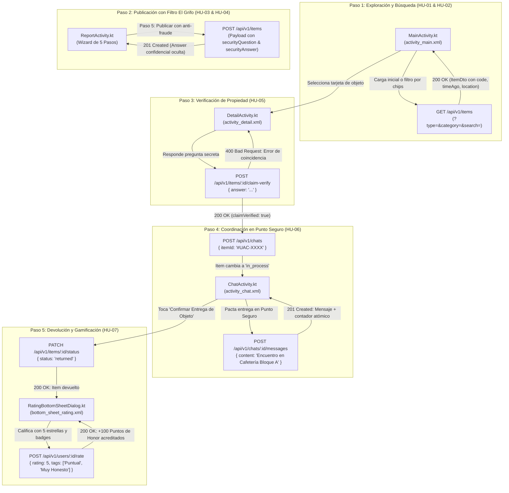

# Contratos de API REST — UniFind Mobile MVP (Sin Auth)

**Proyecto:** UniFind — Red de Contacto y Objetos Perdidos en Campus  
**Institución:** Corporación Universitaria Autónoma del Cauca (Popayán)  
**Asignatura:** Desarrollo Móvil / Bases de Datos Avanzadas — Semestre 6  
**Audiencia Técnica:** Desarrolladores Móviles Android (Kotlin / Jetpack Compose / Retrofit / Ktor)  
**Documento Base de Requerimientos:** [`HISTORIAS_DE_USUARIO_MVP.md`](file:///Users/salomontilla/Universidad/semestre_6/bd_avanzadas/parcial2/HISTORIAS_DE_USUARIO_MVP.md)  
**Versión de API:** `v1`  

---

## 1. Introducción y Configuración de Red para Android

El backend de **UniFind** expone una API REST moderna, rápida y preconfigurada para el consumo directo desde aplicaciones móviles Android. Para agilizar la evaluación académica y las pruebas de laboratorio en emuladores sin fricciones de inicio de sesión, la API opera bajo la premisa de **Modo "Sin Auth"** durante la fase de MVP.

### 1.1 Direcciones Base de Red (Base URL)

Dependiendo del entorno de ejecución de la aplicación Android, configure la URL base correspondiente en su cliente HTTP:

| Entorno de Prueba | Base URL | Observaciones |
| :--- | :--- | :--- |
| **Emulador Oficial de Android Studio** | `http://10.0.2.2:3000/api/v1` | **Recomendada para pruebas.** La IP virtual `10.0.2.2` redirige al `127.0.0.1` de la máquina anfitriona (host). |
| **Dispositivo Físico en Red Wi-Fi Local (LAN)** | `http://192.168.1.X:3000/api/v1` | Reemplace `192.168.1.X` por la dirección IP local de su computadora. Ambos dispositivos deben compartir la misma red Wi-Fi. |
| **Simulador Genymotion** | `http://10.0.3.2:3000/api/v1` | IP de loopback predeterminada para el enrutador virtual de Genymotion. |
| **Pruebas Locales (Postman / Thunder Client / Desktop)** | `http://localhost:3000/api/v1` | Pruebas de escritorio directas en la misma máquina. |

---

### 1.2 Headers HTTP y Modo "Sin Auth"

* **Header Mandatorio:**
  ```http
  Content-Type: application/json
  Accept: application/json
  ```
* **Autenticación:**  
  **No se requiere Bearer Token ni API Key**. Todos los endpoints son públicos.
* **Gestión de Identidad Comunitaria Automática:**  
  Cuando una petición de creación de reporte (`POST /items`), apertura de chat (`POST /chats`), envío de mensaje (`POST /messages`) o cierre de devolución (`PATCH /items/:id/status`) no envíe identificadores de usuario (`postedBy`, `claimantId`, `senderId`, `returnedTo`), el backend asigna automáticamente identidades comunitarias precargadas en el campus:
  * **Custodio / Hallador por Defecto:** Carlos Andrés Muñoz (`670c1f1e1c9d440000a10001` - Código: `2023-1001`).
  * **Reclamante por Defecto:** Valentina Gómez Restrepo (`670c1f1e1c9d440000a10002` - Código: `2022-2045`).

---

### 1.3 Configuración de Tráfico Cleartext HTTP en Android

A partir de Android 9.0 (API 28), el sistema operativo bloquea por seguridad el tráfico HTTP en texto plano (no cifrado). Para permitir la conexión al servidor de desarrollo local:

#### Opción A: En `AndroidManifest.xml` (Rápida para desarrollo)
```xml
<application
    android:allowBackup="true"
    android:usesCleartextTraffic="true"
    android:theme="@style/Theme.UniFind">
    ...
</application>
```

#### Opción B: Mediante Archivo de Configuración de Seguridad de Red (Recomendada)
1. Cree el archivo `res/xml/network_security_config.xml`:
   ```xml
   <?xml version="1.0" encoding="utf-8"?>
   <network-security-config>
       <domain-config cleartextTrafficPermitted="true">
           <domain includeSubdomains="true">10.0.2.2</domain>
           <domain includeSubdomains="true">localhost</domain>
           <domain includeSubdomains="true">192.168.1.0/24</domain>
       </domain-config>
   </network-security-config>
   ```
2. Vincúlelo en `AndroidManifest.xml`:
   ```xml
   <application
       android:networkSecurityConfig="@xml/network_security_config"
       ...>
   ```

---

## 2. Tabla Resumen de Endpoints del MVP (Mapeo HU-01 a HU-07)

| Historia de Usuario | Endpoint | Verbo HTTP | Vista Android & Controlador | Propósito en la Aplicación Móvil |
| :--- | :--- | :---: | :--- | :--- |
| **HU-01** | `/items` | `GET` | `activity_main.xml`<br>`MainActivity.kt` | Consultar el feed inicial con badges, ubicación de campus, tiempo relativo y códigos `#UAC-XXXX`. |
| **HU-02** | `/items` | `GET` | `activity_main.xml`<br>`MainActivity.kt` | Filtrado dinámico por estado (`lost`/`found`), chips de categoría y búsqueda textual. |
| **HU-03** | `/items` | `POST` | `activity_report.xml`<br>`ReportActivity.kt` | Registrar un nuevo reporte de objeto mediante el Wizard de publicación con atributos y ubicación. |
| **HU-04** | `/items` | `POST` | `activity_report.xml`<br>`ReportActivity.kt` | Configurar pregunta de seguridad confidencial (Filtro El Grifo) en el paso 5 del Wizard de reporte. |
| **HU-05** | `/items/:id`<br>`/items/:id/claim-verify` | `GET`<br>`POST` | `activity_detail.xml`<br>`DetailActivity.kt` | Consultar ficha técnica completa y validar respuesta de seguridad para verificar titularidad. |
| **HU-06** | `/chats`<br>`/chats/:id/messages` | `POST`<br>`POST` | `activity_chat.xml`<br>`ChatActivity.kt` | Iniciar/recuperar canal de chat seguro, transicionar objeto a `in_process` y enviar mensajes atómicos. |
| **HU-07** | `/items/:id/status`<br>`/users/:id/rate` | `PATCH`<br>`POST` | `bottom_sheet_rating.xml`<br>`RatingBottomSheetDialog.kt` | Cerrar reporte como devuelto (`returned`) y adjudicar calificación con **+100 Puntos de Honor** y badges. |

---

## 3. Especificación Detallada por Historia de Usuario

---

### HU-01: Visualización del Catálogo de Objetos en Campus

#### Objetivo de Negocio
Permitir a los estudiantes explorar de forma inmediata el feed principal de publicaciones activas en la universidad, visualizando tarjetas enriquecidas con iconos, tiempo relativo (`timeAgo`), ubicación de campus (`campusLocation`), salón de referencia (`roomReference`), código institucional (`#UAC-XXXX`) y etiquetas de verificación requerida.

* **Endpoint:** `GET /items`
* **Vista Android:** `activity_main.xml`
* **Controlador:** `MainActivity.kt`
* **Parámetros de Consulta (Query Params):**
  * `page` (Entero, Opcional, por defecto `1`): Número de página.
  * `limit` (Entero, Opcional, por defecto `20`): Cantidad de registros por página.

#### Request HTTP de Ejemplo
```http
GET /api/v1/items?limit=20&page=1 HTTP/1.1
Host: 10.0.2.2:3000
Accept: application/json
```

#### Response Exitosa (200 OK)
```json
{
  "success": true,
  "statusCode": 200,
  "total": 5,
  "page": 1,
  "totalPages": 1,
  "count": 5,
  "data": [
    {
      "_id": "670c1f1e1c9d440000b20001",
      "id": "670c1f1e1c9d440000b20001",
      "code": "#UAC-8841",
      "title": "Calculadora Científica Casio fx-570ES",
      "type": "found",
      "status": "active",
      "category": "electronics",
      "description": "Calculadora científica gris con tapa protectora encontrada en el Laboratorio 201 después de clase.",
      "campusLocation": "Sede Principal · Edificio A",
      "roomReference": "Lab 201",
      "timeAgo": "Hace 2 horas",
      "securityQuestion": "¿Qué iniciales están grabadas en el reverso?",
      "requiresVerification": true,
      "rewardPoints": 100,
      "location": {
        "campus": "Sede Principal",
        "building": "Edificio A",
        "specificArea": "Lab 201"
      },
      "attributes": {
        "color": "Gris oscuro",
        "modelo": "fx-570ES Plus",
        "estadoFisico": "Excelente"
      },
      "tags": [
        "calculadora",
        "casio",
        "ingenieria",
        "laboratorio",
        "electronica"
      ],
      "privacy": {
        "isAnonymous": true,
        "postedBy": {
          "_id": "670c1f1e1c9d440000a10001",
          "fullName": "Usuario Anónimo",
          "isAnonymous": true
        },
        "claimQuestion": "¿Qué iniciales están grabadas en el reverso?"
      },
      "returnedTo": null,
      "createdAt": "2026-11-01T19:30:00.000Z",
      "updatedAt": "2026-11-01T19:30:00.000Z"
    }
  ]
}
```

#### Manejo de Campos Amigables para Móvil:
* `code`: Cadena formateada para pintar directamente en el badge superior de la tarjeta (ej. `"#UAC-8841"`).
* `campusLocation`: Texto listo para el TextView secundario (ej. `"Sede Principal · Edificio A"`).
* `roomReference`: Texto corto del aula o área de hallazgo (ej. `"Lab 201"`).
* `timeAgo`: Cálculo amigable directo desde el servidor (ej. `"Hace 2 horas"`, `"Hace 15 min"`, `"Reciente"`).
* `requiresVerification`: Booleano para decidir si el botón de la tarjeta debe decir **"Verificar Propiedad"** (`true`) o abrir chat directo (`false`).

---

### HU-02: Filtrado Dinámico por Estado y Categoría

#### Objetivo de Negocio
Permitir al usuario filtrar en tiempo real el catálogo entre objetos perdidos (`lost`) o encontrados (`found`), aplicar chips de categorías universitarias (`electronics`, `documents`, `clothing`, etc.) y buscar por palabras clave o códigos (`#UAC-8841`).

* **Endpoint:** `GET /items`
* **Vista Android:** `activity_main.xml` (Toggle Buttons + Category ChipGroup + SearchView)
* **Controlador:** `MainActivity.kt`
* **Parámetros de Consulta (Query Params):**
  * `type` (String, Opcional): `'lost'` o `'found'`.
  * `category` (String, Opcional): Categoría técnica. El backend normaliza variantes en inglés o español (ej. `'electrónica'`, `'electronics'`, `'documentos'`, `'ropa'`, `'libros'`).
  * `search` (String, Opcional): Término de búsqueda de texto completo en título, descripción y tags, o coincidencia exacta si se ingresa un código (ej. `"calculadora"`, `"UAC-8841"`).
  * `building` (String, Opcional): Filtro por bloque o edificio (ej. `"Edificio A"`).
  * `status` (String, Opcional): Estado del reporte (por defecto `'active'`). Enviar `'all'` para ver histórico.

#### Request HTTP de Ejemplo
```http
GET /api/v1/items?type=found&category=electronics&search=calculadora HTTP/1.1
Host: 10.0.2.2:3000
Accept: application/json
```

#### Response Exitosa (200 OK)
```json
{
  "success": true,
  "statusCode": 200,
  "total": 1,
  "page": 1,
  "totalPages": 1,
  "count": 1,
  "data": [
    {
      "id": "670c1f1e1c9d440000b20001",
      "code": "#UAC-8841",
      "title": "Calculadora Científica Casio fx-570ES",
      "type": "found",
      "status": "active",
      "category": "electronics",
      "description": "Calculadora científica gris con tapa protectora encontrada en el Laboratorio 201 después de clase.",
      "campusLocation": "Sede Principal · Edificio A",
      "roomReference": "Lab 201",
      "timeAgo": "Hace 2 horas",
      "requiresVerification": true,
      "rewardPoints": 100
    }
  ]
}
```

---

### HU-03 & HU-04: Publicación de Reporte y Configuración Anti-Fraude (Filtro El Grifo)

#### Objetivo de Negocio
Permitir registrar formalmente un objeto hallado o extraviado mediante el Wizard de 5 pasos en `ReportActivity.kt`. En el **Paso 5**, el hallador formula una pregunta secreta (`securityQuestion`) y su respuesta (`securityAnswer`) para prevenir reclamos fraudulentos. El backend almacena la respuesta confidencialmente y **nunca la expone** en ninguna consulta pública.

* **Endpoint:** `POST /items`
* **Vista Android:** `activity_report.xml`
* **Controlador:** `ReportActivity.kt`
* **Headers:** `Content-Type: application/json`

#### Estructura del Payload JSON (Soporta Campos Planos o Anidados del Móvil)
```json
{
  "title": "Audífonos Sony WH-1000XM4",
  "situation": "encontrado",
  "category": "electronics",
  "description": "Audífonos inalámbricos de diadema negros encontrados en mesa de laboratorio.",
  "campusLocation": "Sede Principal · Edificio B",
  "roomReference": "Laboratorio 302",
  "attributes": {
    "color": "Negro",
    "estuche": "Gris rígido con cable USB-C"
  },
  "tags": ["audifonos", "sony", "laboratorio", "tecnologia"],
  "isAnonymous": true,
  "securityQuestion": "¿Qué sticker distintivo tiene pegado el estuche de viaje?",
  "securityAnswer": "Sticker de Tux Linux"
}
```

#### Response Exitosa (201 Created)
```json
{
  "success": true,
  "statusCode": 201,
  "message": "Reporte de objeto registrado exitosamente en la comunidad Uniautónoma",
  "data": {
    "_id": "670c5a2e1c9d440000c30005",
    "id": "670c5a2e1c9d440000c30005",
    "code": "#UAC-4912",
    "title": "Audífonos Sony WH-1000XM4",
    "type": "found",
    "status": "active",
    "category": "electronics",
    "description": "Audífonos inalámbricos de diadema negros encontrados en mesa de laboratorio.",
    "campusLocation": "Sede Principal · Edificio B",
    "roomReference": "Laboratorio 302",
    "timeAgo": "Reciente",
    "securityQuestion": "¿Qué sticker distintivo tiene pegado el estuche de viaje?",
    "requiresVerification": true,
    "rewardPoints": 100,
    "privacy": {
      "isAnonymous": true,
      "postedBy": {
        "_id": "670c1f1e1c9d440000a10001",
        "fullName": "Usuario Anónimo",
        "isAnonymous": true
      },
      "claimQuestion": "¿Qué sticker distintivo tiene pegado el estuche de viaje?"
    },
    "createdAt": "2026-11-01T21:40:00.000Z"
  }
}
```
> [!NOTE]
> Observe cómo el campo `securityAnswer` / `claimAnswer` fue **eliminado de forma estricta** de la respuesta JSON por el controlador de privacidad, asegurando la confidencialidad del Filtro El Grifo (Criterio HU-04 Escenario 2).

#### Response de Error por Validación (400 Bad Request)
```json
{
  "success": false,
  "statusCode": 400,
  "error": "El título del objeto es obligatorio"
}
```

---

### HU-05: Validación de Pertenencia mediante Pregunta de Seguridad

#### Objetivo de Negocio
Permitir al dueño legítimo que visualiza la ficha técnica en `DetailActivity.kt` contestar la pregunta de comprobación formulada por el custodio. La validación en el servidor normaliza automáticamente tildes, mayúsculas y espacios en blanco. Si la respuesta coincide, se autoriza la apertura del chat privado de entrega.

#### Subflujo A: Consulta de Ficha Técnica
* **Endpoint:** `GET /items/:id`  
  *(Nota: El parámetro `:id` acepta tanto el `ObjectId` de MongoDB como el código visible, ej: `UAC-8841` o `#UAC-8841`)*.
* **Response (200 OK):** Retorna la ficha técnica con `securityQuestion`, `campusLocation`, `roomReference` y `rewardPoints` sin revelar `claimAnswer`.

#### Subflujo B: Verificación de Respuesta Secreta
* **Endpoint:** `POST /items/:id/claim-verify`
* **Vista Android:** `activity_detail.xml` (Campo de texto de verificación + Botón "Verificar Propiedad y Abrir Chat")
* **Controlador:** `DetailActivity.kt`
* **Parámetros de Ruta:** `:id` (ObjectId o Código `#UAC-8841`).

#### Request HTTP de Ejemplo
```http
POST /api/v1/items/UAC-8841/claim-verify HTTP/1.1
Host: 10.0.2.2:3000
Content-Type: application/json

{
  "answer": "CM"
}
```

#### Response Exitosa (200 OK — Coincidencia Confirmada)
```json
{
  "success": true,
  "statusCode": 200,
  "claimVerified": true,
  "message": "Respuesta correcta. Propiedad verificada satisfactoriamente. Ahora puede iniciar el chat de entrega segura.",
  "itemId": "670c1f1e1c9d440000b20001",
  "itemCode": "#UAC-8841",
  "claimantId": "670c1f1e1c9d440000a10002"
}
```

#### Response de Error (400 Bad Request — Respuesta Incorrecta)
```json
{
  "success": false,
  "statusCode": 400,
  "claimVerified": false,
  "message": "La respuesta no coincide con los detalles registrados por quien encontró el objeto"
}
```

#### Response de Error por Campo Vacío (400 Bad Request)
```json
{
  "success": false,
  "statusCode": 400,
  "error": "El campo answer o claimAnswer con la respuesta de comprobación es obligatorio"
}
```

---

### HU-06: Coordinación de Cita en Punto Seguro de Campus

#### Objetivo de Negocio
Habilitar una conversación privada entre el hallador y el reclamante verificado para pactar el encuentro físico en un **Punto Seguro del Campus** (ej. *Cafetería Bloque A*, *Bienestar Universitario*). Al crearse el chat, el objeto pasa automáticamente a estado `in_process` en MongoDB para bloquear reclamos de terceros.

#### Subflujo A: Apertura o Recuperación Idempotente del Chat
* **Endpoint:** `POST /chats`
* **Vista Android:** Transición desde `DetailActivity.kt` hacia `ChatActivity.kt`.
* **Payload JSON:**
  ```json
  {
    "itemId": "#UAC-8841"
  }
  ```
  *(El backend soporta pasar `itemId` como `_id` de Mongo o código `#UAC-8841`, y auto-vincula al reclamante comunitario si no se especifica `claimantId`)*.

#### Response Exitosa (201 Created o 200 OK si ya existía)
```json
{
  "success": true,
  "statusCode": 201,
  "message": "Chat privado creado exitosamente y estado del objeto actualizado a in_process",
  "data": {
    "_id": "670c1f1e1c9d440000d40001",
    "itemId": {
      "_id": "670c1f1e1c9d440000b20001",
      "code": "#UAC-8841",
      "title": "Calculadora Científica Casio fx-570ES",
      "status": "in_process",
      "location": {
        "campus": "Sede Principal",
        "building": "Edificio A",
        "specificArea": "Lab 201"
      }
    },
    "participants": [
      {
        "_id": "670c1f1e1c9d440000a10001",
        "fullName": "Carlos Andrés Muñoz",
        "studentCode": "2023-1001",
        "institutionalEmail": "carlos.munoz@uniautonoma.edu.co"
      },
      {
        "_id": "670c1f1e1c9d440000a10002",
        "fullName": "Valentina Gómez Restrepo",
        "studentCode": "2022-2045",
        "institutionalEmail": "valentina.gomez@uniautonoma.edu.co"
      }
    ],
    "status": "open",
    "unreadCount": {
      "670c1f1e1c9d440000a10001": 0,
      "670c1f1e1c9d440000a10002": 0
    }
  }
}
```

---

#### Subflujo B: Envío de Mensaje en la Conversación
* **Endpoint:** `POST /chats/:id/messages`
* **Vista Android:** `activity_chat.xml` (Barra de entrada inferior y botón Enviar)
* **Controlador:** `ChatActivity.kt`
* **Parámetros de Ruta:** `:id` (Identificador del chat, ej. `670c1f1e1c9d440000d40001`).

#### Request HTTP de Ejemplo
```http
POST /api/v1/chats/670c1f1e1c9d440000d40001/messages HTTP/1.1
Host: 10.0.2.2:3000
Content-Type: application/json

{
  "content": "Hola Carlos, podemos encontrarnos en la Cafetería del Bloque A a las 3:00 PM frente a la garita de seguridad."
}
```

#### Response Exitosa (201 Created)
```json
{
  "success": true,
  "statusCode": 201,
  "message": "Mensaje enviado y conversación actualizada atómicamente",
  "data": {
    "_id": "670c634e1c9d440000e50010",
    "chatId": "670c1f1e1c9d440000d40001",
    "senderId": {
      "_id": "670c1f1e1c9d440000a10002",
      "fullName": "Valentina Gómez Restrepo",
      "institutionalEmail": "valentina.gomez@uniautonoma.edu.co"
    },
    "content": "Hola Carlos, podemos encontrarnos en la Cafetería del Bloque A a las 3:00 PM frente a la garita de seguridad.",
    "attachments": [],
    "isRead": false,
    "sentAt": "2026-11-01T21:45:00.000Z"
  },
  "chatSummary": {
    "chatId": "670c1f1e1c9d440000d40001",
    "status": "open",
    "lastMessage": {
      "senderId": "670c1f1e1c9d440000a10002",
      "text": "Hola Carlos, podemos encontrarnos en la Cafetería del Bloque A a las 3:00 PM frente a la garita de seguridad.",
      "sentAt": "2026-11-01T21:45:00.000Z"
    },
    "unreadCount": {
      "670c1f1e1c9d440000a10001": 1
    }
  }
}
```

---

#### Subflujo C: Obtener Historial de Mensajes del Chat
* **Endpoint:** `GET /chats/:id/messages`
* **Response (200 OK):**
```json
{
  "success": true,
  "statusCode": 200,
  "count": 2,
  "data": [
    {
      "_id": "670c1f1e1c9d440000e50001",
      "chatId": "670c1f1e1c9d440000d40001",
      "senderId": {
        "_id": "670c1f1e1c9d440000a10002",
        "fullName": "Valentina Gómez Restrepo"
      },
      "content": "Hola Carlos, acabo de verificar la propiedad de la calculadora Casio.",
      "sentAt": "2026-11-01T20:00:00.000Z"
    },
    {
      "_id": "670c634e1c9d440000e50010",
      "chatId": "670c1f1e1c9d440000d40001",
      "senderId": {
        "_id": "670c1f1e1c9d440000a10002",
        "fullName": "Valentina Gómez Restrepo"
      },
      "content": "Hola Carlos, podemos encontrarnos en la Cafetería del Bloque A a las 3:00 PM frente a la garita de seguridad.",
      "sentAt": "2026-11-01T21:45:00.000Z"
    }
  ]
}
```

---

### HU-07: Confirmación de Devolución y Adjudicación de Puntos de Honor

#### Objetivo de Negocio
Permitir al usuario que recuperó su objeto formalizar el cierre exitoso del caso en dos pasos sincronizados:
1. Actualizar el estado del objeto a devuelto (`returned`), vinculando al estudiante receptor.
2. Abrir el modal `RatingBottomSheetDialog.kt`, asignar una calificación de 1 a 5 estrellas, seleccionar reconocimientos de camaradería (ej. *"Puntual"*, *"Muy Honesto"*) y adjudicar **+100 Puntos de Honor** al hallador solidario.

#### Subflujo A: Cierre de Reporte a Estado "Devuelto"
* **Endpoint:** `PATCH /items/:id/status`
* **Parámetros de Ruta:** `:id` (ObjectId o Código `#UAC-8841`).
* **Request HTTP:**
  ```json
  {
    "status": "returned"
  }
  ```
* **Response Exitosa (200 OK):**
  ```json
  {
    "success": true,
    "statusCode": 200,
    "message": "Estado del reporte actualizado exitosamente a 'returned'",
    "data": {
      "id": "670c1f1e1c9d440000b20001",
      "code": "#UAC-8841",
      "title": "Calculadora Científica Casio fx-570ES",
      "status": "returned",
      "returnedTo": {
        "_id": "670c1f1e1c9d440000a10002",
        "fullName": "Valentina Gómez Restrepo",
        "studentCode": "2022-2045"
      }
    }
  }
  ```

---

#### Subflujo B: Adjudicación de Puntos de Honor y Badges
* **Endpoint:** `POST /users/:id/rate`
* **Vista Android:** `bottom_sheet_rating.xml`
* **Controlador:** `RatingBottomSheetDialog.kt`
* **Parámetros de Ruta:** `:id` (Identificador del custodio o hallador a calificar, ej. Carlos Muñoz `670c1f1e1c9d440000a10001`).

#### Request HTTP de Ejemplo
```http
POST /api/v1/users/670c1f1e1c9d440000a10001/rate HTTP/1.1
Host: 10.0.2.2:3000
Content-Type: application/json

{
  "rating": 5,
  "comment": "Excelente honestidad, me devolvió la calculadora en perfecto estado y a la hora convenida.",
  "tags": ["Puntual", "Muy Honesto", "Custodio Confiable"],
  "itemId": "670c1f1e1c9d440000b20001"
}
```

#### Response Exitosa (200 OK — +100 Puntos Acreditados)
```json
{
  "success": true,
  "statusCode": 200,
  "message": "Calificación registrada exitosamente, +100 Puntos de Honor acreditados y reputación actualizada",
  "data": {
    "userId": "670c1f1e1c9d440000a10001",
    "fullName": "Carlos Andrés Muñoz",
    "studentCode": "2023-1001",
    "institutionalEmail": "carlos.munoz@uniautonoma.edu.co",
    "reputation": {
      "returnedCount": 3,
      "rating": 4.9,
      "honorPoints": 300,
      "badges": [
        "Puntual",
        "Custodio Confiable",
        "Muy Honesto"
      ]
    },
    "evaluatedDetails": {
      "submittedRating": 5,
      "raterId": null,
      "itemId": "670c1f1e1c9d440000b20001",
      "comment": "Excelente honestidad, me devolvió la calculadora en perfecto estado y a la hora convenida.",
      "awardedHonorPoints": 100,
      "awardedBadges": [
        "Puntual",
        "Muy Honesto",
        "Custodio Confiable"
      ]
    }
  }
}
```

#### Response de Error por Calificación Inválida (400 Bad Request)
```json
{
  "success": false,
  "statusCode": 400,
  "error": "La calificación debe ser un valor numérico entre 1 y 5 estrellas"
}
```

---

## 4. Diagrama de Flujo Integral del MVP (Mermaid)

El siguiente diagrama detalla la interacción de los controladores móviles Android con los endpoints de la API REST de UniFind a lo largo de todo el ciclo de vida del MVP:



---

## 5. Modelos Data Class de Kotlin Sugeridos (DTOs)

Para facilitar una integración limpia y directa con bibliotecas modernas como **Retrofit**, **Ktor Client** o **kotlinx.serialization**, a continuación se suministran las estructuras de datos preparadas para copiar en su módulo Android:

```kotlin
package co.edu.uniautonoma.unifind.data.model

import kotlinx.serialization.SerialName
import kotlinx.serialization.Serializable

/**
 * Envoltorio genérico para respuestas de la API UniFind
 */
@Serializable
data class ApiResponse<T>(
    @SerialName("success") val success: Boolean,
    @SerialName("statusCode") val statusCode: Int,
    @SerialName("message") val message: String? = null,
    @SerialName("error") val error: String? = null,
    @SerialName("data") val data: T? = null
)

/**
 * Envoltorio para respuestas paginadas del catálogo (HU-01 & HU-02)
 */
@Serializable
data class PaginatedResponse<T>(
    @SerialName("success") val success: Boolean,
    @SerialName("statusCode") val statusCode: Int,
    @SerialName("total") val total: Int = 0,
    @SerialName("page") val page: Int = 1,
    @SerialName("totalPages") val totalPages: Int = 1,
    @SerialName("count") val count: Int = 0,
    @SerialName("data") val data: List<T> = emptyList()
)

/**
 * DTO principal de Objeto/Pertenencia para tarjetas y detalle
 */
@Serializable
data class ItemDto(
    @SerialName("id") val id: String? = null,
    @SerialName("_id") val mongoId: String? = null,
    @SerialName("code") val code: String = "#UAC-0000",
    @SerialName("title") val title: String,
    @SerialName("type") val type: String, // "lost" o "found"
    @SerialName("status") val status: String = "active", // "active", "in_process", "returned"
    @SerialName("category") val category: String,
    @SerialName("description") val description: String = "",
    @SerialName("campusLocation") val campusLocation: String = "Sede Principal",
    @SerialName("roomReference") val roomReference: String = "Campus",
    @SerialName("timeAgo") val timeAgo: String = "Reciente",
    @SerialName("securityQuestion") val securityQuestion: String = "",
    @SerialName("requiresVerification") val requiresVerification: Boolean = false,
    @SerialName("rewardPoints") val rewardPoints: Int = 100,
    @SerialName("tags") val tags: List<String> = emptyList(),
    @SerialName("createdAt") val createdAt: String? = null
)

/**
 * Payload para publicar un reporte (HU-03 & HU-04)
 */
@Serializable
data class CreateReportRequest(
    @SerialName("title") val title: String,
    @SerialName("situation") val situation: String, // "encontrado" o "perdido"
    @SerialName("category") val category: String,
    @SerialName("description") val description: String,
    @SerialName("campusLocation") val campusLocation: String,
    @SerialName("roomReference") val roomReference: String,
    @SerialName("attributes") val attributes: Map<String, String> = emptyMap(),
    @SerialName("tags") val tags: List<String> = emptyList(),
    @SerialName("isAnonymous") val isAnonymous: Boolean = false,
    @SerialName("securityQuestion") val securityQuestion: String? = null,
    @SerialName("securityAnswer") val securityAnswer: String? = null
)

/**
 * Payload y Respuesta para verificación de pregunta secreta (HU-05)
 */
@Serializable
data class ClaimVerifyRequest(
    @SerialName("answer") val answer: String,
    @SerialName("claimantId") val claimantId: String? = null
)

@Serializable
data class ClaimVerifyResponse(
    @SerialName("success") val success: Boolean,
    @SerialName("claimVerified") val claimVerified: Boolean,
    @SerialName("message") val message: String,
    @SerialName("itemId") val itemId: String? = null,
    @SerialName("itemCode") val itemCode: String? = null,
    @SerialName("claimantId") val claimantId: String? = null
)

/**
 * DTOs de Conversación y Mensajería (HU-06)
 */
@Serializable
data class CreateChatRequest(
    @SerialName("itemId") val itemId: String
)

@Serializable
data class ChatDto(
    @SerialName("_id") val id: String,
    @SerialName("status") val status: String,
    @SerialName("participants") val participants: List<UserSummaryDto> = emptyList(),
    @SerialName("lastMessage") val lastMessage: LastMessageDto? = null
)

@Serializable
data class SendMessageRequest(
    @SerialName("content") val content: String,
    @SerialName("senderId") val senderId: String? = null
)

@Serializable
data class MessageDto(
    @SerialName("_id") val id: String,
    @SerialName("chatId") val chatId: String,
    @SerialName("senderId") val senderId: UserSummaryDto? = null,
    @SerialName("content") val content: String,
    @SerialName("sentAt") val sentAt: String? = null
)

@Serializable
data class LastMessageDto(
    @SerialName("text") val text: String,
    @SerialName("sentAt") val sentAt: String? = null
)

/**
 * DTOs para Cierre y Puntos de Honor (HU-07)
 */
@Serializable
data class UpdateStatusRequest(
    @SerialName("status") val status: String = "returned"
)

@Serializable
data class RateUserRequest(
    @SerialName("rating") val rating: Int = 5,
    @SerialName("comment") val comment: String? = null,
    @SerialName("tags") val tags: List<String> = emptyList(),
    @SerialName("itemId") val itemId: String? = null
)

@Serializable
data class UserSummaryDto(
    @SerialName("_id") val id: String,
    @SerialName("fullName") val fullName: String,
    @SerialName("studentCode") val studentCode: String? = null,
    @SerialName("institutionalEmail") val institutionalEmail: String? = null
)

@Serializable
data class RateUserResponseData(
    @SerialName("userId") val userId: String,
    @SerialName("fullName") val fullName: String,
    @SerialName("reputation") val reputation: ReputationDto,
    @SerialName("evaluatedDetails") val evaluatedDetails: EvaluatedDetailsDto? = null
)

@Serializable
data class ReputationDto(
    @SerialName("returnedCount") val returnedCount: Int,
    @SerialName("rating") val rating: Double,
    @SerialName("honorPoints") val honorPoints: Int,
    @SerialName("badges") val badges: List<String> = emptyList()
)

@Serializable
data class EvaluatedDetailsDto(
    @SerialName("submittedRating") val submittedRating: Int,
    @SerialName("comment") val comment: String? = null,
    @SerialName("awardedHonorPoints") val awardedHonorPoints: Int = 100,
    @SerialName("awardedBadges") val awardedBadges: List<String> = emptyList()
)
```

---

## 6. Ejemplo de Servicio Retrofit en Android (Kotlin)

```kotlin
package co.edu.uniautonoma.unifind.data.remote

import co.edu.uniautonoma.unifind.data.model.*
import retrofit2.Response
import retrofit2.http.*

interface UniFindApiService {

    // HU-01 & HU-02: Catálogo con filtros dinámicos
    @GET("items")
    suspend fun getItems(
        @Query("type") type: String? = null,
        @Query("category") category: String? = null,
        @Query("search") search: String? = null,
        @Query("building") building: String? = null,
        @Query("status") status: String? = "active",
        @Query("page") page: Int = 1,
        @Query("limit") limit: Int = 20
    ): Response<PaginatedResponse<ItemDto>>

    // HU-05: Detalle de ítem (acepta ObjectId o código como UAC-8841)
    @GET("items/{id}")
    suspend fun getItemDetail(
        @Path("id") itemIdOrCode: String
    ): Response<ApiResponse<ItemDto>>

    // HU-03 & HU-04: Publicación de reporte con Filtro El Grifo
    @POST("items")
    suspend fun createReport(
        @Body request: CreateReportRequest
    ): Response<ApiResponse<ItemDto>>

    // HU-05: Validación de pregunta de seguridad anti-fraude
    @POST("items/{id}/claim-verify")
    suspend fun verifyClaim(
        @Path("id") itemIdOrCode: String,
        @Body request: ClaimVerifyRequest
    ): Response<ClaimVerifyResponse>

    // HU-06: Apertura o recuperación de chat
    @POST("chats")
    suspend fun createChat(
        @Body request: CreateChatRequest
    ): Response<ApiResponse<ChatDto>>

    // HU-06: Envío de mensaje en chat de entrega
    @POST("chats/{id}/messages")
    suspend fun sendMessage(
        @Path("id") chatId: String,
        @Body request: SendMessageRequest
    ): Response<ApiResponse<MessageDto>>

    // HU-06: Historial de mensajes
    @GET("chats/{id}/messages")
    suspend fun getChatMessages(
        @Path("id") chatId: String
    ): Response<ApiResponse<List<MessageDto>>>

    // HU-07: Cierre del reporte a devuelto
    @PATCH("items/{id}/status")
    suspend fun updateItemStatus(
        @Path("id") itemIdOrCode: String,
        @Body request: UpdateStatusRequest
    ): Response<ApiResponse<ItemDto>>

    // HU-07: Calificación y acreditación de +100 Puntos de Honor
    @POST("users/{id}/rate")
    suspend fun rateUser(
        @Path("id") userId: String,
        @Body request: RateUserRequest
    ): Response<ApiResponse<RateUserResponseData>>
}
```

---

## 7. Conclusión y Checklist de Integración

Antes de iniciar la sustentación o pruebas en el dispositivo/emulador, verifique:
1. El backend esté en ejecución (`node index.js` o `nodemon index.js`) en el puerto `3000`.
2. Haya ejecutado `npm run seed` para contar con los objetos precargados de prueba (`#UAC-8841`, `#UAC-2045`, `#UAC-3088`, `#UAC-4091`).
3. La URL base en Android apunte a `http://10.0.2.2:3000/api/v1` en emulador o la IP local en dispositivo físico.
4. `usesCleartextTraffic="true"` esté declarado en el `AndroidManifest.xml`.
