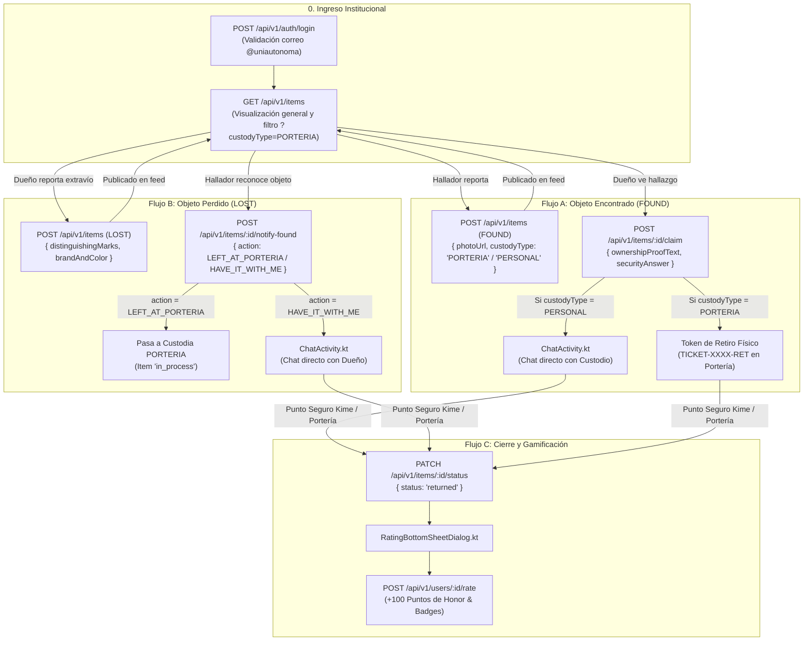

# Contratos de API REST — UniFind Mobile MVP (Flujos Portería y Dueño)

**Proyecto:** UniFind — Red de Contacto, Custodia en Portería y Objetos Perdidos  
**Institución:** Corporación Universitaria Autónoma del Cauca (Popayán)  
**Asignatura:** Desarrollo Móvil / Bases de Datos Avanzadas — Semestre 6  
**Audiencia Técnica:** Desarrolladores Móviles Android (Kotlin / Jetpack Compose / Retrofit / Ktor)  
**Documento Base de Historias:** [`HISTORIAS_DE_USUARIO_MVP.md`](file:///Users/salomontilla/Universidad/semestre_6/bd_avanzadas/parcial2/HISTORIAS_DE_USUARIO_MVP.md)  
**Versión de API:** `v1`  

---

## 1. Introducción y Configuración de Red para Android

El backend de **UniFind** está sincronizado con la aplicación móvil Android y sus dos flujos operativos clave:
1. **Flujo A (Modo Exprés Portería - FOUND):** El hallador publica rápidamente con fotografía, zona del campus y tipo de custodia (`PORTERIA` o `PERSONAL`). El reclamo genera un **Token de Retiro físico** (`TICKET-XXXX-RET`) si está en portería, o un chat directo si es custodia personal.
2. **Flujo B (Modo Detallado Dueño - LOST):** El propietario publica con señas particulares detalladas (`distinguishingMarks`), marca y color. La comunidad notifica su hallazgo mediante aviso (`notify-found`), ya sea dejándolo en portería (`LEFT_AT_PORTERIA`) o llevándolo consigo (`HAVE_IT_WITH_ME`).
3. **Flujo C (Login Institucional y Gamificación):** Autenticación y auto-registro transparente (`POST /auth/login`), filtro de portería en el feed, chat con Punto Seguro Kime, y acreditación de **+100 Puntos de Honor** en la calificación final.

---

### 1.1 Direcciones Base de Red (Base URL)

| Entorno de Prueba | Base URL | Observaciones |
| :--- | :--- | :--- |
| **Emulador Oficial de Android Studio** | `http://10.0.2.2:3000/api/v1` | **Recomendada para pruebas.** La IP virtual `10.0.2.2` redirige al `127.0.0.1` del host. |
| **Dispositivo Físico en Wi-Fi Local (LAN)** | `http://192.168.1.X:3000/api/v1` | Reemplace `192.168.1.X` por la IP local de su computadora de desarrollo. |
| **Simulador Genymotion** | `http://10.0.3.2:3000/api/v1` | IP de loopback predeterminada de Genymotion. |
| **Pruebas de Escritorio (Postman / Thunder)** | `http://localhost:3000/api/v1` | Pruebas directas en la máquina local. |

---

### 1.2 Headers HTTP y Modo "Sin Auth" con Auto-Login

* **Headers Obligatorios:**
  ```http
  Content-Type: application/json
  Accept: application/json
  ```
* **Autenticación:**  
  La API no exige Bearer Tokens para operar. Para validar la pertenencia universitaria, la app ejecuta un **Login Transparente** (`POST /api/v1/auth/login`) con el correo institucional `@uniautonoma.edu.co`. Si el usuario no existía previamente, el backend lo auto-registra al instante asignándole **100 Puntos de Honor** iniciales.
* **Identidades Comunitarias de Respaldo:**  
  Si un payload omite `postedBy`, `claimantId`, `finderId` o `returnedTo`, el backend asigna automáticamente los usuarios precargados del campus:
  * **Custodio / Hallador por Defecto:** Carlos Andrés Muñoz (`670c1f1e1c9d440000a10001`).
  * **Reclamante / Dueña por Defecto:** Valentina Gómez Restrepo (`670c1f1e1c9d440000a10002`).

---

### 1.3 Configuración de Tráfico Cleartext HTTP en Android

En Android 9+ (API 28+), declare el soporte para tráfico HTTP local en `res/xml/network_security_config.xml`:
```xml
<?xml version="1.0" encoding="utf-8"?>
<network-security-config>
    <domain-config cleartextTrafficPermitted="true">
        <domain includeSubdomains="true">10.0.2.2</domain>
        <domain includeSubdomains="true">localhost</domain>
        <domain includeSubdomains="true">192.168.1.0/24</domain>
    </domain-config>
</network-security-config>
```

Y vincúlelo en `AndroidManifest.xml`:
```xml
<application
    android:networkSecurityConfig="@xml/network_security_config"
    android:usesCleartextTraffic="true"
    ...>
```

---

## 2. Tabla Resumen de Endpoints del MVP

| Historia / Flujo | Endpoint | Verbo HTTP | Vista Android & Controlador | Propósito en la App Móvil |
| :--- | :--- | :---: | :--- | :--- |
| **HU-00** | `/auth/login` | `POST` | `activity_login.xml`<br>`LoginActivity.kt` | Login institucional o auto-registro transparente con correo `@uniautonoma.edu.co`. |
| **HU-01** | `/items` | `GET` | `activity_main.xml`<br>`MainActivity.kt` | Feed principal enriquecido con fotos, badges, `custodyType`, `timeAgo` y códigos `#UAC-XXXX`. |
| **HU-02** | `/items` | `GET` | `activity_main.xml`<br>`MainActivity.kt` | Filtro exclusivo de portería (`?custodyType=PORTERIA`), estado (`lost`/`found`) y categorías. |
| **HU-03 (Flujo A)** | `/items` | `POST` | `activity_report.xml`<br>`ReportActivity.kt` | Publicación exprés de hallazgo (`FOUND`) con `photoUrl`, `campusZone`, `custodyType` (`PORTERIA`/`PERSONAL`). |
| **HU-04 (Flujo B)** | `/items` | `POST` | `activity_report.xml`<br>`ReportActivity.kt` | Publicación detallada de extravío (`LOST`) con señas particulares (`distinguishingMarks`), marca y color. |
| **HU-05 (Flujo A)** | `/items/:id/claim` | `POST` | `activity_detail.xml`<br>`DetailActivity.kt` | Reclamo de objeto encontrado. Si es `PORTERIA` genera `deliveryToken`; si es `PERSONAL` abre chat. |
| **HU-05 (Seguridad)**| `/items/:id/claim-verify` | `POST` | `activity_detail.xml`<br>`DetailActivity.kt` | Validación semántica de pregunta secreta anti-fraude (Filtro El Grifo). |
| **HU-06 (Flujo B)** | `/items/:id/notify-found` | `POST` | `activity_detail.xml`<br>`DetailActivity.kt` | Notificar hallazgo de objeto perdido (`LEFT_AT_PORTERIA` o `HAVE_IT_WITH_ME`). |
| **HU-06 (Chat)** | `/chats/:id/messages` | `POST` | `activity_chat.xml`<br>`ChatActivity.kt` | Mensajería instantánea coordinando la entrega en Punto Seguro Kime con actualización atómica. |
| **HU-07 (Cierre)** | `/items/:id/status` | `PATCH` | `activity_chat.xml`<br>`ChatActivity.kt` | Transicionar el estado del reporte a devuelto (`returned`) y asociar al receptor. |
| **HU-07 (Honor)** | `/users/:id/rate` | `POST` | `bottom_sheet_rating.xml`<br>`RatingBottomSheetDialog.kt` | Calificar con estrellas, añadir reconocimientos y adjudicar **+100 Puntos de Honor**. |
| **HU-08 (Perfil)** | `/users/:id/profile` | `GET` / `PUT` | `activity_profile.xml`<br>`ProfileScreen.kt` | Consultar perfil, rango cívico, medallas, saldo de honor y actualizar datos de contacto. |
| **HU-08 (Mis Reportes)** | `/users/:id/items` | `GET` | `activity_profile.xml`<br>`ProfileScreen.kt` | Listar exclusivamente las publicaciones creadas por el usuario autenticado. |
| **HU-09 (Ticket Portería)** | `/items/tickets/:token` | `GET` | `activity_porteria.xml`<br>`PorteriaScreen.kt` | Consultar validez de ticket digital de retiro, identificando al reclamante y pertenencia física. |
| **HU-09 (Despacho Portería)** | `/items/tickets/:token/confirm-delivery` | `POST` | `activity_porteria.xml`<br>`PorteriaScreen.kt` | Confirmar entrega física en portería, pasando el ítem a `returned` y cerrando el ticket. |
| **HU-10 (DevOps / Health)** | `/health` / `/api/v1/health` | `GET` | Cloud Monitoring | Health check de la API y verificación de conexión a MongoDB en producción. |

---

## 3. Especificación Detallada de Contratos por Endpoint

---

### 3.1 HU-00: Login Institucional y Auto-Registro Transparente

Permite el ingreso seguro de la comunidad universitaria. Si el usuario ya existe, devuelve su perfil con puntos de honor acumulados. Si ingresa por primera vez, se auto-registra sin fricción.

* **Endpoint:** `POST /api/v1/auth/login`
* **Headers:** `Content-Type: application/json`

#### Request de Ejemplo
```json
{
  "institutionalEmail": "carlos.munoz@uniautonoma.edu.co",
  "studentCode": "2023-1001",
  "fullName": "Carlos Andrés Muñoz"
}
```

#### Response Exitosa (200 OK)
```json
{
  "success": true,
  "statusCode": 200,
  "message": "Sesión iniciada exitosamente",
  "data": {
    "_id": "670c1f1e1c9d440000a10001",
    "fullName": "Carlos Andrés Muñoz",
    "institutionalEmail": "carlos.munoz@uniautonoma.edu.co",
    "studentCode": "2023-1001",
    "phone": "3104567890",
    "reputation": {
      "returnedCount": 2,
      "rating": 4.9,
      "honorPoints": 200,
      "badges": ["Puntual", "Custodio Confiable"]
    },
    "createdAt": "2026-11-01T20:00:00.000Z"
  }
}
```

#### Response de Error (400 Bad Request — Dominio no permitido)
```json
{
  "success": false,
  "statusCode": 400,
  "error": "El correo debe ser institucional con dominio @uniautonoma.edu.co"
}
```

---

### 3.2 HU-01 & HU-02: Feed de Catálogo y Filtro de Portería

Permite listar los reportes con paginación, alternar entre estados, buscar por texto y filtrar exclusivamente los artículos resguardados en las porterías institucionales.

* **Endpoint:** `GET /api/v1/items`
* **Query Params Disponibles:**
  * `custodyType`: `'PORTERIA'` o `'PERSONAL'` *(Filtro clave para la pestaña "En Portería")*.
  * `porteria`: `'true'` *(Alias rápido para `custodyType=PORTERIA`)*.
  * `type`: `'found'` (Encontrados) o `'lost'` (Perdidos).
  * `category`: Categoría (`'electronics'`, `'documents'`, `'clothing'`, `'books'`, `'accessories'`).
  * `search`: Búsqueda textual por palabras clave o código visible (ej. `"UAC-8841"` o `"calculadora"`).
  * `page` (Entero, def: 1), `limit` (Entero, def: 20).

#### Request HTTP de Ejemplo (Filtro Portería)
```http
GET /api/v1/items?custodyType=PORTERIA&type=found&limit=10 HTTP/1.1
Host: 10.0.2.2:3000
Accept: application/json
```

#### Response Exitosa (200 OK)
```json
{
  "success": true,
  "statusCode": 200,
  "total": 2,
  "page": 1,
  "totalPages": 1,
  "count": 2,
  "data": [
    {
      "id": "670c1f1e1c9d440000b10004",
      "code": "#UAC-4091",
      "title": "Termo metálico azul tipo Stanley",
      "type": "found",
      "status": "active",
      "category": "clothing",
      "custodyType": "PORTERIA",
      "brandAndColor": "Stanley Azul Mate",
      "photoUrl": "https://images.unsplash.com/photo-1544816155-12df9643f363?w=500",
      "campusLocation": "Sede Principal · Edificio B",
      "roomReference": "Cafetería piso 1",
      "timeAgo": "Hace 1 hora",
      "securityQuestion": "¿Qué sticker tiene pegado en la parte inferior?",
      "requiresVerification": true,
      "rewardPoints": 100,
      "distinguishingMarks": ""
    },
    {
      "id": "670c1f1e1c9d440000b10006",
      "code": "#UAC-9933",
      "title": "Auriculares Inalámbricos Sony WH-1000XM4",
      "type": "found",
      "status": "active",
      "category": "electronics",
      "custodyType": "PORTERIA",
      "brandAndColor": "Sony Negro Mate",
      "photoUrl": "https://images.unsplash.com/photo-1505740420928-5e560c06d30e?w=500",
      "campusLocation": "Sede Principal · Biblioteca",
      "roomReference": "Sala de estudio piso 2",
      "timeAgo": "Hace 30 min",
      "requiresVerification": false,
      "rewardPoints": 100
    }
  ]
}
```

---

### 3.3 HU-03: Flujo A — Publicación Exprés en Portería (`FOUND`)

Diseñado para quien encontró un objeto y desea publicarlo rápidamente con foto, zona del campus y marcando si lo dejó en la portería o lo custodia personalmente.

* **Endpoint:** `POST /api/v1/items`
* **Headers:** `Content-Type: application/json`

#### Request de Ejemplo (FOUND — Custodia PORTERIA)
```json
{
  "type": "found",
  "title": "Calculadora Científica Casio fx-570ES",
  "category": "electronics",
  "custodyType": "PORTERIA",
  "campusZone": "Edificio A",
  "locationReference": "Lab 201",
  "brandAndColor": "Casio Gris Oscuro",
  "photoUrl": "https://images.unsplash.com/photo-1594980596870-8aa52a78d8cd?w=500",
  "securityQuestion": "¿Qué iniciales están grabadas en el reverso?",
  "securityAnswer": "CM"
}
```

#### Response Exitosa (201 Created)
```json
{
  "success": true,
  "statusCode": 201,
  "message": "Reporte de objeto (FOUND) registrado exitosamente",
  "data": {
    "id": "670c5a2e1c9d440000c30005",
    "code": "#UAC-8841",
    "title": "Calculadora Científica Casio fx-570ES",
    "type": "found",
    "status": "active",
    "category": "electronics",
    "custodyType": "PORTERIA",
    "brandAndColor": "Casio Gris Oscuro",
    "photoUrl": "https://images.unsplash.com/photo-1594980596870-8aa52a78d8cd?w=500",
    "campusLocation": "Sede Principal · Edificio A",
    "roomReference": "Lab 201",
    "timeAgo": "Reciente",
    "securityQuestion": "¿Qué iniciales están grabadas en el reverso?",
    "requiresVerification": true,
    "rewardPoints": 100,
    "createdAt": "2026-11-02T01:00:00.000Z"
  }
}
```
> [!NOTE]
> La respuesta confidencial (`securityAnswer`) fue **eliminada** de la respuesta JSON para preservar el secreto anti-fraude.

---

### 3.4 HU-04: Flujo B — Publicación Detallada por el Propietario (`LOST`)

Diseñado para quien perdió una pertenencia y necesita especificar marcas y señas particulares para facilitar su reconocimiento.

* **Endpoint:** `POST /api/v1/items`
* **Headers:** `Content-Type: application/json`

#### Request de Ejemplo (LOST — Detallado Dueño)
```json
{
  "type": "lost",
  "title": "Billetera de cuero con carnet y tarjeta débito",
  "category": "documents",
  "campusZone": "Cafetería Central",
  "locationReference": "Mesa cerca a la fotocopiadora",
  "brandAndColor": "Cuero negro Vélez",
  "distinguishingMarks": "Billetera con sticker de Ingeniería y firma en el carnet institucional",
  "photoUrl": "https://images.unsplash.com/photo-1627123424574-724758594e93?w=500"
}
```

#### Response Exitosa (201 Created)
```json
{
  "success": true,
  "statusCode": 201,
  "message": "Reporte de objeto (LOST) registrado exitosamente",
  "data": {
    "id": "670c5a2e1c9d440000c30006",
    "code": "#UAC-2045",
    "title": "Billetera de cuero con carnet y tarjeta débito",
    "type": "lost",
    "status": "active",
    "category": "documents",
    "custodyType": null,
    "distinguishingMarks": "Billetera con sticker de Ingeniería y firma en el carnet institucional",
    "brandAndColor": "Cuero negro Vélez",
    "photoUrl": "https://images.unsplash.com/photo-1627123424574-724758594e93?w=500",
    "campusLocation": "Sede Principal · Cafetería Central",
    "roomReference": "Mesa cerca a la fotocopiadora",
    "timeAgo": "Reciente",
    "requiresVerification": false,
    "rewardPoints": 100,
    "createdAt": "2026-11-02T01:05:00.000Z"
  }
}
```

---

### 3.5 HU-05: Flujo A — Reclamo de Objeto Encontrado (`claim`)

Permite al dueño reclamar una pertenencia encontrada.
* Si el objeto tiene `custodyType === 'PORTERIA'`: Aprueba el reclamo y genera un **Token de Retiro físico** (`deliveryToken`) para canjear en la garita.
* Si el objeto tiene `custodyType === 'PERSONAL'`: Aprueba el reclamo y **abre automáticamente un canal de chat privado** con el custodio.

* **Endpoint:** `POST /api/v1/items/:id/claim`  
  *(Acepta `:id` como ObjectId de Mongo o código `#UAC-8841`)*

#### Request de Ejemplo
```json
{
  "ownershipProofText": "Soy el titular del carnet 2022-2045 y la calculadora tiene mis iniciales CM.",
  "securityAnswer": "CM"
}
```

#### Response Exitosa — Caso 1: Custodia en PORTERIA (Token de Retiro)
```json
{
  "success": true,
  "statusCode": 200,
  "claimApproved": true,
  "custodyType": "PORTERIA",
  "deliveryToken": "TICKET-7841-RET",
  "pickupLocation": "Portería Principal - Campus Uniautónoma",
  "message": "Reclamo aprobado exitosamente. Presenta este token en la Portería Principal para retirar el objeto.",
  "data": {
    "id": "670c1f1e1c9d440000b10004",
    "code": "#UAC-4091",
    "title": "Termo metálico azul tipo Stanley",
    "status": "in_process",
    "custodyType": "PORTERIA"
  }
}
```

#### Response Exitosa — Caso 2: Custodia PERSONAL (Apertura de Chat)
```json
{
  "success": true,
  "statusCode": 200,
  "claimApproved": true,
  "custodyType": "PERSONAL",
  "chatId": "670c1f1e1c9d440000c10001",
  "message": "Reclamo aprobado. Se ha habilitado el canal de chat seguro con la persona que custodia el objeto.",
  "data": {
    "id": "670c1f1e1c9d440000b10001",
    "code": "#UAC-8841",
    "status": "in_process",
    "custodyType": "PERSONAL"
  }
}
```

#### Response de Error (400 Bad Request — Respuesta de seguridad incorrecta)
```json
{
  "success": false,
  "statusCode": 400,
  "claimApproved": false,
  "error": "La respuesta de seguridad no coincide con los detalles del custodio"
}
```

---

### 3.6 HU-06: Flujo B — Notificación de Hallazgo de Objeto Perdido (`notify-found`)

Permite a quien encontró un objeto que figuraba como perdido avisarle al dueño dónde está.

* **Endpoint:** `POST /api/v1/items/:id/notify-found`
* **Acciones Posibles (`action`):**
  * `LEFT_AT_PORTERIA`: Lo entregó en la portería del campus.
  * `HAVE_IT_WITH_ME`: Lo tiene en su poder y abre un chat con el dueño.

#### Request de Ejemplo 1 (`LEFT_AT_PORTERIA`)
```json
{
  "action": "LEFT_AT_PORTERIA",
  "finderNote": "Lo entregué al vigilante de la Portería del Bloque B hace 10 minutos."
}
```

#### Response Exitosa (`LEFT_AT_PORTERIA` - 200 OK)
```json
{
  "success": true,
  "statusCode": 200,
  "action": "LEFT_AT_PORTERIA",
  "custodyType": "PORTERIA",
  "message": "Notificación registrada con éxito. El objeto ha quedado registrado bajo custodia de Portería.",
  "data": {
    "id": "670c1f1e1c9d440000b10002",
    "code": "#UAC-2045",
    "title": "Carnet Estudiantil y Tarjeta Bancaria",
    "status": "in_process",
    "custodyType": "PORTERIA"
  }
}
```

#### Request de Ejemplo 2 (`HAVE_IT_WITH_ME`)
```json
{
  "action": "HAVE_IT_WITH_ME",
  "finderNote": "Hola, lo tengo conmigo en la biblioteca piso 2."
}
```

#### Response Exitosa (`HAVE_IT_WITH_ME` - 200 OK — Chat Automático Creado)
```json
{
  "success": true,
  "statusCode": 200,
  "action": "HAVE_IT_WITH_ME",
  "custodyType": "PERSONAL",
  "chatId": "670c1f1e1c9d440000c10002",
  "message": "Notificación registrada. Se ha habilitado el chat directo entre el hallador y el dueño del objeto.",
  "data": {
    "id": "670c1f1e1c9d440000b10002",
    "code": "#UAC-2045",
    "status": "in_process",
    "custodyType": "PERSONAL"
  }
}
```

---

### 3.7 HU-06 (Chat): Mensajería con Tarjeta de Punto Seguro Kime

Permite intercambiar mensajes en la conversación para pactar la entrega física en un Punto Seguro del Campus (ej. *Cafetería Bloque A / Bienestar*).

* **Endpoint:** `POST /api/v1/chats/:id/messages`
* **Headers:** `Content-Type: application/json`

#### Request de Ejemplo
```json
{
  "content": "Hola Carlos, te espero a las 3:00 PM en el Punto Seguro Kime frente a la Cafetería del Bloque A."
}
```

#### Response Exitosa (201 Created)
```json
{
  "success": true,
  "statusCode": 201,
  "message": "Mensaje enviado y conversación actualizada atómicamente",
  "data": {
    "_id": "670c634e1c9d440000e50010",
    "chatId": "670c1f1e1c9d440000c10001",
    "senderId": {
      "_id": "670c1f1e1c9d440000a10002",
      "fullName": "Valentina Gómez Restrepo"
    },
    "content": "Hola Carlos, te espero a las 3:00 PM en el Punto Seguro Kime frente a la Cafetería del Bloque A.",
    "isRead": false,
    "sentAt": "2026-11-02T01:15:00.000Z"
  },
  "chatSummary": {
    "chatId": "670c1f1e1c9d440000c10001",
    "status": "open",
    "lastMessage": {
      "senderId": "670c1f1e1c9d440000a10002",
      "text": "Hola Carlos, te espero a las 3:00 PM en el Punto Seguro Kime frente a la Cafetería del Bloque A.",
      "sentAt": "2026-11-02T01:15:00.000Z"
    },
    "unreadCount": {
      "670c1f1e1c9d440000a10001": 1
    }
  }
}
```

---

### 3.8 HU-07: Cierre de Reporte y Adjudicación de +100 Puntos de Honor

Formaliza la restitución física del objeto en dos pasos:

#### Paso 1: Cierre a Estado Devuelto (`PATCH /api/v1/items/:id/status`)
```http
PATCH /api/v1/items/UAC-8841/status HTTP/1.1
Host: 10.0.2.2:3000
Content-Type: application/json

{
  "status": "returned"
}
```
**Response (200 OK):**
```json
{
  "success": true,
  "statusCode": 200,
  "message": "Estado del reporte actualizado exitosamente a 'returned'",
  "data": {
    "id": "670c1f1e1c9d440000b10001",
    "code": "#UAC-8841",
    "status": "returned"
  }
}
```

#### Paso 2: Calificación y +100 Puntos de Honor (`POST /api/v1/users/:id/rate`)
```http
POST /api/v1/users/670c1f1e1c9d440000a10001/rate HTTP/1.1
Host: 10.0.2.2:3000
Content-Type: application/json

{
  "rating": 5,
  "comment": "Excelente honestidad, me entregó el termo en perfecto estado en portería.",
  "tags": ["Puntual", "Muy Honesto", "Custodio Confiable"],
  "itemId": "670c1f1e1c9d440000b10001"
}
```
**Response Exitosa (200 OK — +100 Puntos de Honor Acreditados):**
```json
{
  "success": true,
  "statusCode": 200,
  "message": "Calificación registrada exitosamente, +100 Puntos de Honor acreditados y reputación actualizada",
  "data": {
    "userId": "670c1f1e1c9d440000a10001",
    "fullName": "Carlos Andrés Muñoz",
    "studentCode": "2023-1001",
    "reputation": {
      "returnedCount": 3,
      "rating": 4.9,
      "honorPoints": 300,
      "badges": ["Puntual", "Custodio Confiable", "Muy Honesto"]
    },
    "evaluatedDetails": {
      "submittedRating": 5,
      "comment": "Excelente honestidad, me entregó el termo en perfecto estado en portería.",
      "awardedHonorPoints": 100,
      "awardedBadges": ["Puntual", "Muy Honesto", "Custodio Confiable"]
    }
  }
}
```

---

## 4. Diagrama de Flujo Integral del MVP (Mermaid)

El siguiente diagrama detalla la arquitectura de bifurcación entre el **Flujo A (Modo Exprés Portería)** y el **Flujo B (Modo Detallado Dueño)**:



---

## 5. Modelos Data Class de Kotlin Sugeridos (DTOs)

Modelos estructurados con `@Serializable` de `kotlinx.serialization` para parseo directo en Android:

```kotlin
package co.edu.uniautonoma.unifind.data.model

import kotlinx.serialization.SerialName
import kotlinx.serialization.Serializable

@Serializable
data class ApiResponse<T>(
    @SerialName("success") val success: Boolean,
    @SerialName("statusCode") val statusCode: Int,
    @SerialName("message") val message: String? = null,
    @SerialName("error") val error: String? = null,
    @SerialName("data") val data: T? = null
)

@Serializable
data class PaginatedResponse<T>(
    @SerialName("success") val success: Boolean,
    @SerialName("statusCode") val statusCode: Int,
    @SerialName("total") val total: Int = 0,
    @SerialName("page") val page: Int = 1,
    @SerialName("totalPages") val totalPages: Int = 1,
    @SerialName("count") val count: Int = 0,
    @SerialName("data") val data: List<T> = emptyList()
)

/**
 * DTO Principal de Ítem sincronizado con Portería y Señas
 */
@Serializable
data class ItemDto(
    @SerialName("id") val id: String? = null,
    @SerialName("_id") val mongoId: String? = null,
    @SerialName("code") val code: String = "#UAC-0000",
    @SerialName("title") val title: String,
    @SerialName("type") val type: String, // "found" o "lost"
    @SerialName("status") val status: String = "active", // "active", "in_process", "returned"
    @SerialName("category") val category: String,
    @SerialName("custodyType") val custodyType: String? = null, // "PORTERIA", "PERSONAL" o null
    @SerialName("distinguishingMarks") val distinguishingMarks: String = "",
    @SerialName("brandAndColor") val brandAndColor: String = "",
    @SerialName("photoUrl") val photoUrl: String = "",
    @SerialName("campusLocation") val campusLocation: String = "Sede Principal",
    @SerialName("roomReference") val roomReference: String = "Campus",
    @SerialName("timeAgo") val timeAgo: String = "Reciente",
    @SerialName("securityQuestion") val securityQuestion: String = "",
    @SerialName("requiresVerification") val requiresVerification: Boolean = false,
    @SerialName("rewardPoints") val rewardPoints: Int = 100,
    @SerialName("claimRecord") val claimRecord: ClaimRecordDto? = null,
    @SerialName("createdAt") val createdAt: String? = null
)

/**
 * Payload Flujo A: Modo Exprés Portería (FOUND)
 */
@Serializable
data class CreateFoundExpressRequest(
    @SerialName("type") val type: String = "found",
    @SerialName("title") val title: String,
    @SerialName("category") val category: String,
    @SerialName("custodyType") val custodyType: String = "PORTERIA", // "PORTERIA" o "PERSONAL"
    @SerialName("campusZone") val campusZone: String,
    @SerialName("locationReference") val locationReference: String = "",
    @SerialName("brandAndColor") val brandAndColor: String = "",
    @SerialName("photoUrl") val photoUrl: String,
    @SerialName("securityQuestion") val securityQuestion: String? = null,
    @SerialName("securityAnswer") val securityAnswer: String? = null
)

/**
 * Payload Flujo B: Modo Detallado Dueño (LOST)
 */
@Serializable
data class CreateLostDetailedRequest(
    @SerialName("type") val type: String = "lost",
    @SerialName("title") val title: String,
    @SerialName("category") val category: String,
    @SerialName("campusZone") val campusZone: String,
    @SerialName("locationReference") val locationReference: String = "",
    @SerialName("brandAndColor") val brandAndColor: String = "",
    @SerialName("distinguishingMarks") val distinguishingMarks: String,
    @SerialName("photoUrl") val photoUrl: String? = null
)

/**
 * Reclamo de objeto encontrado (Flujo A)
 */
@Serializable
data class ClaimRequest(
    @SerialName("ownershipProofText") val ownershipProofText: String,
    @SerialName("securityAnswer") val securityAnswer: String? = null
)

@Serializable
data class ClaimResponse(
    @SerialName("success") val success: Boolean,
    @SerialName("claimApproved") val claimApproved: Boolean,
    @SerialName("custodyType") val custodyType: String, // "PORTERIA" o "PERSONAL"
    @SerialName("deliveryToken") val deliveryToken: String? = null,
    @SerialName("pickupLocation") val pickupLocation: String? = null,
    @SerialName("chatId") val chatId: String? = null,
    @SerialName("message") val message: String,
    @SerialName("data") val data: ItemDto? = null
)

/**
 * Notificación de hallazgo de objeto perdido (Flujo B)
 */
@Serializable
data class NotifyFoundRequest(
    @SerialName("action") val action: String, // "LEFT_AT_PORTERIA" o "HAVE_IT_WITH_ME"
    @SerialName("finderNote") val finderNote: String? = null
)

@Serializable
data class NotifyFoundResponse(
    @SerialName("success") val success: Boolean,
    @SerialName("action") val action: String,
    @SerialName("custodyType") val custodyType: String,
    @SerialName("chatId") val chatId: String? = null,
    @SerialName("message") val message: String,
    @SerialName("data") val data: ItemDto? = null
)

/**
 * DTOs de Autenticación
 */
@Serializable
data class LoginRequest(
    @SerialName("institutionalEmail") val institutionalEmail: String,
    @SerialName("studentCode") val studentCode: String? = null,
    @SerialName("fullName") val fullName: String? = null
)

@Serializable
data class UserDto(
    @SerialName("_id") val id: String,
    @SerialName("fullName") val fullName: String,
    @SerialName("institutionalEmail") val institutionalEmail: String,
    @SerialName("studentCode") val studentCode: String,
    @SerialName("reputation") val reputation: ReputationDto
)

@Serializable
data class ReputationDto(
    @SerialName("returnedCount") val returnedCount: Int,
    @SerialName("rating") val rating: Double,
    @SerialName("honorPoints") val honorPoints: Int,
    @SerialName("badges") val badges: List<String> = emptyList()
)

@Serializable
data class ClaimRecordDto(
    @SerialName("ownershipProofText") val ownershipProofText: String = "",
    @SerialName("deliveryToken") val deliveryToken: String = "",
    @SerialName("status") val status: String = "pending"
)

@Serializable
data class RateUserRequest(
    @SerialName("rating") val rating: Int = 5,
    @SerialName("comment") val comment: String? = null,
    @SerialName("tags") val tags: List<String> = emptyList(),
    @SerialName("itemId") val itemId: String? = null
)
```

---

## 6. Interfaz Retrofit para Android (Kotlin)

```kotlin
package co.edu.uniautonoma.unifind.data.remote

import co.edu.uniautonoma.unifind.data.model.*
import retrofit2.Response
import retrofit2.http.*

interface UniFindApiService {

    // HU-00: Login Institucional
    @POST("auth/login")
    suspend fun login(
        @Body request: LoginRequest
    ): Response<ApiResponse<UserDto>>

    // HU-01 & HU-02: Catálogo con filtro de portería y chips
    @GET("items")
    suspend fun getItems(
        @Query("custodyType") custodyType: String? = null, // "PORTERIA" o "PERSONAL"
        @Query("type") type: String? = null,               // "found" o "lost"
        @Query("category") category: String? = null,
        @Query("search") search: String? = null,
        @Query("page") page: Int = 1,
        @Query("limit") limit: Int = 20
    ): Response<PaginatedResponse<ItemDto>>

    // Ficha técnica por ID o código (#UAC-8841)
    @GET("items/{id}")
    suspend fun getItemDetail(
        @Path("id") itemIdOrCode: String
    ): Response<ApiResponse<ItemDto>>

    // HU-03: Flujo A - Publicación Exprés en Portería (FOUND)
    @POST("items")
    suspend fun createFoundExpress(
        @Body request: CreateFoundExpressRequest
    ): Response<ApiResponse<ItemDto>>

    // HU-04: Flujo B - Publicación Detallada Dueño (LOST)
    @POST("items")
    suspend fun createLostDetailed(
        @Body request: CreateLostDetailedRequest
    ): Response<ApiResponse<ItemDto>>

    // HU-05: Flujo A - Reclamo (genera Token o abre Chat)
    @POST("items/{id}/claim")
    suspend fun claimItem(
        @Path("id") itemIdOrCode: String,
        @Body request: ClaimRequest
    ): Response<ClaimResponse>

    // HU-06: Flujo B - Notificación de hallazgo (LEFT_AT_PORTERIA / HAVE_IT_WITH_ME)
    @POST("items/{id}/notify-found")
    suspend fun notifyFound(
        @Path("id") itemIdOrCode: String,
        @Body request: NotifyFoundRequest
    ): Response<NotifyFoundResponse>

    // HU-06: Envío de mensaje en Punto Seguro Kime
    @POST("chats/{id}/messages")
    suspend fun sendMessage(
        @Path("id") chatId: String,
        @Body messagePayload: Map<String, String>
    ): Response<ApiResponse<Any>>

    // HU-07: Cierre de reporte a 'returned'
    @PATCH("items/{id}/status")
    suspend fun updateStatus(
        @Path("id") itemIdOrCode: String,
        @Body statusPayload: Map<String, String> // { "status": "returned" }
    ): Response<ApiResponse<ItemDto>>

    // HU-07: Calificación con +100 Puntos de Honor
    @POST("users/{id}/rate")
    suspend fun rateUser(
        @Path("id") userId: String,
        @Body request: RateUserRequest
    ): Response<ApiResponse<Any>>

    // HU-08: Perfil integral, rango de honor y estadísticas
    @GET("users/{id}/profile")
    suspend fun getUserProfile(
        @Path("id") userId: String
    ): Response<ApiResponse<UserProfileData>>

    // HU-08: Actualizar datos de contacto en perfil
    @PUT("users/{id}/profile")
    suspend fun updateUserProfile(
        @Path("id") userId: String,
        @Body request: UpdateProfileRequest
    ): Response<ApiResponse<UserDto>>

    // HU-08: Listar publicaciones creadas por el usuario
    @GET("users/{id}/items")
    suspend fun getUserItems(
        @Path("id") userId: String,
        @Query("status") status: String? = null,
        @Query("type") type: String? = null
    ): Response<PaginatedResponse<ItemDto>>

    // HU-09: Consultar validez y datos de Ticket en Portería
    @GET("items/tickets/{token}")
    suspend fun getTicketDetails(
        @Path("token") deliveryToken: String
    ): Response<ApiResponse<TicketDetailsData>>

    // HU-09: Confirmar entrega física en Portería mediante Ticket
    @POST("items/tickets/{token}/confirm-delivery")
    suspend fun confirmTicketDelivery(
        @Path("token") deliveryToken: String,
        @Body request: ConfirmDeliveryRequest
    ): Response<ApiResponse<ConfirmDeliveryResult>>

    // HU-10: Health Check del servidor
    @GET("health")
    suspend fun getHealth(): Response<Map<String, Any>>
}

// -------------------------------------------------------------------------
// DTOs adicionales para HU-08 y HU-09:
// -------------------------------------------------------------------------

@Serializable
data class UserProfileData(
    val user: UserProfileDetails,
    val stats: UserStats,
    val recentItems: List<ItemDto> = emptyList()
)

@Serializable
data class UserProfileDetails(
    val id: String,
    val fullName: String,
    val institutionalEmail: String,
    val studentCode: String,
    val phone: String = "",
    val avatarUrl: String = "",
    val reputation: ReputationDetails
)

@Serializable
data class ReputationDetails(
    val rating: Double,
    val returnedCount: Int,
    val honorPoints: Int,
    val rank: String, // "Guardián Novato", "Custodio Solidario", "Héroe del Campus"
    val badges: List<String> = emptyList()
)

@Serializable
data class UserStats(
    val totalReported: Int,
    val reportedLost: Int,
    val reportedFound: Int,
    val returnedSuccess: Int
)

@Serializable
data class UpdateProfileRequest(
    val fullName: String? = null,
    val phone: String? = null,
    val avatarUrl: String? = null
)

@Serializable
data class TicketDetailsData(
    val deliveryToken: String,
    val isValid: Boolean,
    val isDelivered: Boolean,
    val status: String,
    val pickupLocation: String,
    val item: TicketItemInfo,
    val claimant: TicketClaimantInfo,
    val ownershipProofText: String? = null,
    val claimedAt: String? = null
)

@Serializable
data class TicketItemInfo(
    val id: String,
    val code: String,
    val title: String,
    val category: String,
    val custodyType: String? = null,
    val photoUrl: String? = null,
    val campusLocation: String? = null,
    val specificArea: String? = null
)

@Serializable
data class TicketClaimantInfo(
    val id: String? = null,
    val fullName: String,
    val studentCode: String,
    val institutionalEmail: String,
    val phone: String = ""
)

@Serializable
data class ConfirmDeliveryRequest(
    val guardName: String = "Personal de Portería",
    val guardNotes: String? = null
)

@Serializable
data class ConfirmDeliveryResult(
    val deliveryToken: String,
    val itemCode: String,
    val title: String,
    val status: String,
    val deliveredAt: String,
    val handledBy: String,
    val guardNotes: String? = null
)
```

---

## 7. Checklist de Verificación para Sustentación Móvil

1. **Servidor Local Activo:** Ejecutar `node index.js` en el puerto `3000`.
2. **Poblado con Portería:** Ejecutar `npm run seed` para verificar la existencia de objetos con `custodyType: "PORTERIA"` (`#UAC-4091`, `#UAC-9933`) y objetos perdidos con señas particulares (`#UAC-2045`, `#UAC-3088`).
3. **Prueba Flujo A en Emulador:** Abrir objeto `#UAC-4091`, pulsar "Reclamar Objeto" y verificar la generación en pantalla del ticket `TICKET-XXXX-RET`.
4. **Prueba Flujo B en Emulador:** Abrir objeto `#UAC-2045`, pulsar "Notificar Hallazgo", seleccionar `LEFT_AT_PORTERIA` o `HAVE_IT_WITH_ME` y comprobar la transición a `in_process` o apertura del chat.
5. **Prueba Gamificación:** Cerrar reporte y evidenciar en la base de datos el aumento de `+100 honorPoints`.
