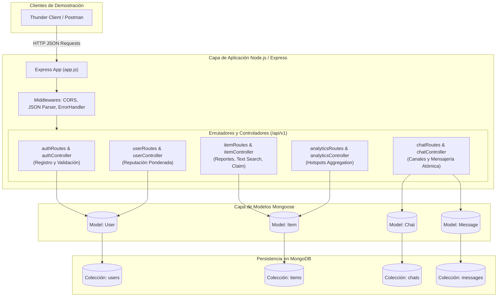
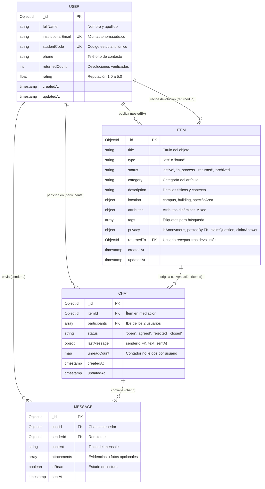

# UniFind — Sistema Universitario de Objetos Perdidos y Red de Contacto

<div align="center">


</div>

---

### Información Académica e Institucional
- **Institución:** Corporación Universitaria Autónoma del Cauca
- **Facultad / Programa:** Facultad de Ingeniería — Ingeniería de Sistemas
- **Asignatura:** Bases de Datos Avanzadas
- **Docente:** Diego Prado (`diego.prado.o@uniautonoma.edu.co`)
- **Evaluación:** Parcial 2 — API REST con Node.js y MongoDB (Evaluación de MVP)
- **Documento de Requerimientos:** [historias-usuarios.md](file:///Users/salomontilla/Universidad/semestre_6/bd_avanzadas/parcial2/historias-usuarios.md)

---

## 1. Descripción del Proyecto

**UniFind** es una solución tecnológica integral de Backend construida como un Producto Mínimo Viable (MVP) para resolver la pérdida recurrente de objetos y pertenencias (calculadoras, carnets, cuadernos, tecnología, prendas) dentro del campus de la **Corporación Universitaria Autónoma del Cauca**.

La plataforma provee una API REST robusta desarrollada en **Node.js** con **Express** y persistencia no relacional en **MongoDB** mediante **Mongoose**. Integra mecanismos avanzados de indexación de texto completo (`$text`), agregaciones multicapa (`Aggregation Pipeline`), actualización atómica de contadores (`$inc` y `$set`), esquema polimórfico flexible (`Schema.Types.Mixed`), y protocolos de comprobación de propiedad que protegen la privacidad de los estudiantes y mitigan reclamos fraudulentos.

---

## 2. Arquitectura de Software y Flujo del Sistema

La arquitectura está estructurada bajo el patrón por capas (**Controller-Service-Model/Router**), garantizando separación de responsabilidades, validaciones estrictas y manejo centralizado de excepciones sin interrupciones del servicio.



---

## 3. Modelo de Datos y Relaciones en MongoDB

UniFind implementa un modelo de datos híbrido optimizado para sistemas universitarios de alta concurrencia, combinando normalización referencial (referencias `ObjectId`) con subdocumentos embebidos e índices secundarios y de texto.



### Índices Estratégicos Creados en la Base de Datos
1. **Colección `users`:**
   - `{ institutionalEmail: 1 }` (Unique)
   - `{ studentCode: 1 }` (Unique)
2. **Colección `items`:**
   - `{ title: 'text', description: 'text', tags: 'text' }` con pesos `{ title: 5, tags: 3, description: 1 }` y lenguaje español para búsqueda full-text optimizada.
   - `{ type: 1, status: 1 }` para filtrado compuesto de publicaciones activas.
   - `{ 'location.building': 1 }` para consultas por bloque y georreferenciación física.
   - `{ category: 1 }` para navegación por categorías.
3. **Colección `chats`:**
   - `{ itemId: 1 }` y `{ participants: 1 }` para recuperación inmediata del canal de entrega.
4. **Colección `messages`:**
   - `{ chatId: 1, sentAt: 1 }` para listar mensajes en orden cronológico ascendente.

---

## 4. Tabla Oficial del Parcial 2 (Punto 11 de la Guía)

A continuación se presenta la tabla oficial de 5 columnas exigida por la rúbrica del Parcial 2 (Punto 11) que mapea las 10 funcionalidades del MVP con su respectiva historia de usuario, endpoint y resultado esperado:

| N.º | Historia de usuario | Funcionalidad | Endpoint y método HTTP | Resultado esperado |
|:---:|---|---|---|---|
| **1** | **HU-01:** Como estudiante universitario, quiero registrarme con mi correo institucional (`@uniautonoma.edu.co`) y código estudiantil, para autenticar mi identidad y acceder confiablemente al sistema. | Registro de usuario institucional con validación de dominio uniautonoma y código único. | `POST /api/v1/auth/register` | **201 Created:** Usuario persistido en MongoDB con reputación inicial (0 devoluciones, 5.0 estrellas) o **400 Bad Request** si el correo es externo o duplicado. |
| **2** | **HU-02:** Como miembro de la comunidad que extravió o encontró un objeto, quiero publicar un reporte polimórfico con detalles del campus, atributos dinámicos y pregunta de comprobación opcional, para visibilizar el caso con protección anti-fraude. | Creación de reporte polimórfico (`lost` o `found`) con soporte de atributos flexibles (`Mixed`), etiquetas y privacidad. | `POST /api/v1/items` | **201 Created:** Reporte almacenado con estado `active`, datos sanitizados y pregunta de seguridad configurada. |
| **3** | **HU-03:** Como estudiante con una pertenencia extraviada, quiero buscar por filtros (tipo, categoría, edificio) o palabras clave mediante búsqueda de texto completo, para encontrar mi objeto rápidamente. | Consulta paginada con filtros multicriterio y motor de búsqueda ponderada mediante índice de texto `$text`. | `GET /api/v1/items` | **200 OK:** Lista de objetos coincidentes ordenados por relevancia de texto (`textScore`) junto con metadatos de paginación (`total`, `page`, `totalPages`). |
| **4** | **HU-04:** Como usuario que inspecciona una publicación, quiero visualizar el detalle del reporte sin ver datos de contacto si es anónimo ni la respuesta de comprobación, para proteger la privacidad del reportante. | Consulta individual de objeto con sanitización estricta de seguridad en capa de negocio. | `GET /api/v1/items/:id` | **200 OK:** Ficha del objeto con `claimAnswer` excluido y datos de `postedBy` anonimizados si `isAnonymous: true`. **404 Not Found** si el ID no existe. |
| **5** | **HU-05:** Como legítimo propietario de un objeto hallado, quiero responder la pregunta de comprobación formulada por quien lo encontró, para demostrar mi titularidad sin revelar mi identidad públicamente. | Comprobación semántica de respuesta de seguridad con normalización Unicode NFD anti-diacríticos. | `POST /api/v1/items/:id/claim-verify` | **200 OK:** `{ "claimVerified": true }` habilitando la apertura del chat si la respuesta coincide, o **400 Bad Request** si es incorrecta. |
| **6** | **HU-06:** Como reportante o reclamante verificado, quiero abrir una conversación privada sobre el objeto, para acordar el punto seguro de entrega pasando el reporte a estado "en proceso". | Apertura o recuperación idempotente de chat y actualización automática del ítem a `in_process`. | `POST /api/v1/chats` | **201 Created:** Canal de chat generado y objeto actualizado a `in_process` en MongoDB (o **200 OK** si ya existía entre las partes). |
| **7** | **HU-07:** Como participante de una mediación de entrega, quiero enviar mensajes en el chat, para coordinar la devolución y actualizar de forma atómica los contadores de lectura del receptor. | Creación de mensaje con actualización atómica de conversación mediante operadores `$set` e `$inc`. | `POST /api/v1/chats/:id/messages` | **201 Created:** Mensaje insertado en `messages` y `Chat` actualizado atómicamente con `lastMessage` e incremento en `unreadCount` del contraparte. |
| **8** | **HU-08:** Como estudiante que devolvió un objeto a su dueño, quiero marcar el reporte como `returned` registrando al estudiante receptor, para formalizar el cierre del caso con trazabilidad institucional. | Actualización del ciclo de vida del objeto a devuelto y vinculación relacional con el receptor (`returnedTo`). | `PATCH /api/v1/items/:id/status` | **200 OK:** Objeto actualizado con `status: "returned"` y campo `returnedTo` poblado con los datos del usuario receptor verificado. |
| **9** | **HU-09:** Como estudiante que recuperó su objeto, quiero calificar de 1 a 5 estrellas a quien me lo devolvió, para reconocer su honestidad y recalcular su índice de reputación en el campus. | Calificación post-entrega con incremento de `returnedCount` y recálculo matemático de promedio ponderado. | `POST /api/v1/users/:id/rate` | **200 OK:** Perfil del usuario actualizado con nueva calificación ponderada (1 decimal) y aumento en contador de devoluciones completadas. |
| **10** | **HU-10:** Como líder de bienestar o directivo del campus, quiero consultar las zonas críticas con mayor pérdida de objetos, para focalizar la vigilancia física y campañas preventivas. | Aggregation Pipeline en MongoDB (`$match`, `$group`, `$sort`, `$limit`, `$project`) para identificar Hotspots de extravíos. | `GET /api/v1/analytics/hotspots` | **200 OK:** Listado analítico agrupado por campus y edificio, con conteo de pérdidas, categorías más afectadas y ejemplos de incidentes recientes. |

> La especificación detallada de cada Historia de Usuario bajo formato Gherkin (Dado/Cuando/Entonces) y su código de consulta en MongoDB se encuentra en [historias-usuarios.md](file:///Users/salomontilla/Universidad/semestre_6/bd_avanzadas/parcial2/historias-usuarios.md).

---

## 5. Requisitos del Sistema e Instalación Paso a Paso

### Requisitos Previos
- **Node.js:** Versión 18.x o superior LTS instalada (`node -v`).
- **npm:** Versión 9.x o superior (`npm -v`).
- **MongoDB:** Servidor local ejecutándose en el puerto estándar `27017` o una instancia en la nube (MongoDB Atlas).
- **Cliente HTTP para Pruebas:** Thunder Client (extensión en VS Code) o Postman.

### Paso 1: Clonar el Repositorio
```bash
git clone <URL_DEL_REPOSITORIO_GITHUB>
cd parcial2
```

### Paso 2: Instalación de Dependencias
Ejecute la instalación de módulos de producción y desarrollo:
```bash
npm install
```

### Paso 3: Configuración de Variables de Entorno
Cree un archivo `.env` en la raíz del proyecto tomando como plantilla el archivo [.env.example](file:///Users/salomontilla/Universidad/semestre_6/bd_avanzadas/parcial2/.env.example):

```bash
cp .env.example .env
```

Contenido del archivo `.env`:
```env
PORT=3000
MONGODB_URI=mongodb://127.0.0.1:27017/unifind_db
NODE_ENV=development
```

> [!NOTE]
> Si utiliza MongoDB Atlas en la nube, reemplace `MONGODB_URI` por su cadena de conexión (`mongodb+srv://<usuario>:<password>@cluster.mongodb.net/unifind_db?retryWrites=true&w=majority`).

### Paso 4: Poblar la Base de Datos con Datos de Prueba
Para cargar usuarios universitarios reales, reportes polimórficos de objetos con preguntas de seguridad y conversaciones de prueba, ejecute:
```bash
npm run seed
```

### Paso 5: Iniciar el Servidor de Desarrollo
Para arrancar el servidor con recarga en caliente vía `nodemon`:
```bash
npm run dev
```
O en modo producción estándar:
```bash
npm start
```

La consola confirmará la conexión exitosa:
```text
[MongoDB] Conectado exitosamente: 127.0.0.1:27017/unifind_db
====================================================
🚀 Servidor UniFind API ejecutándose en el puerto 3000
📍 URL Base: http://localhost:3000/api/v1
📡 Entorno: development
====================================================
```

---

## 6. Script de Poblado Rápido (`npm run seed`)

El proyecto incluye un script automatizado en [seed.js](file:///Users/salomontilla/Universidad/semestre_6/bd_avanzadas/parcial2/seed.js) que resetea las colecciones y precarga un ecosistema universitario coherente y listo para ser sustentado:

### Datos Precargados:
1. **Usuarios Institucionales Registrados:**
   - **Carlos Andrés Muñoz** (`carlos.munoz@uniautonoma.edu.co`, Código: `2023-1001`, Rol: Finder con 2 devoluciones y 4.9 estrellas).
   - **Valentina Gómez Restrepo** (`valentina.gomez@uniautonoma.edu.co`, Código: `2022-2045`, Rol: Propietaria de calculadora con reputación 5.0).
   - **Andrés Felipe Salazar** (`andres.salazar@uniautonoma.edu.co`, Código: `2021-3088`, Rol: Estudiante con objetos extraviados).
2. **Reportes de Objetos Polimórficos:**
   - **Calculadora Científica Casio fx-991LAX:** Hallada en Edificio B (Salón 204), anónima, con pregunta secreta: *"¿De qué color es la tapa protectora y qué iniciales tiene grabadas?"* y respuesta: *"Tapa azul con iniciales CM"*.
   - **Carnet Estudiantil Uniautónoma:** Hallado en Cafetería Central con pregunta secreta de comprobación.
   - **Cuaderno de Cálculo Integral:** Extraviado en Biblioteca (piso 2).
   - **Termo metálico azul tipo Stanley:** Extraviado en Laboratorio de Química (Edificio B).
   - **Chaqueta impermeable negra:** Extraviada en Edificio B (Pasillo piso 3).
3. **Conversación y Mensaje Inicial:** Canal de chat activo entre Carlos y Valentina coordinando la devolución.

---

## 7. Mapeo de Códigos de Estado HTTP y Manejo Centralizado de Errores

La API cumple estrictamente con las convenciones REST y cuenta con un middleware centralizado en [errorHandler.js](file:///Users/salomontilla/Universidad/semestre_6/bd_avanzadas/parcial2/src/middlewares/errorHandler.js) que captura excepciones síncronas y asíncronas:

| Código HTTP | Nombre Estándar | Cuándo se emite en UniFind | Ejemplo de Escenario |
|:---:|---|---|---|
| **200** | `OK` | Consulta o actualización exitosa de recursos existentes. | `GET /api/v1/items`, `GET /api/v1/analytics/hotspots`, `PATCH /api/v1/items/:id/status`, `POST /api/v1/users/:id/rate`. |
| **201** | `Created` | Creación exitosa de un recurso en MongoDB. | `POST /api/v1/auth/register`, `POST /api/v1/items`, `POST /api/v1/chats`, `POST /api/v1/chats/:id/messages`. |
| **400** | `Bad Request` | Petición mal formada, datos inválidos o violación de reglas de negocio. | Correo no institucional, campos obligatorios omitidos, respuesta incorrecta en `claim-verify`, o duplicidad de clave única (Mongo Error 11000). |
| **403** | `Forbidden` | Intento de realizar una acción sin pertenecer a la entidad. | Enviar mensaje a un chat privado en el que el `senderId` no es participante. |
| **404** | `Not Found` | Recurso o ruta no localizada en el servidor o base de datos. | ID de objeto o chat inexistente, o ruta HTTP no mapeada en el router. |
| **500** | `Internal Server Error` | Excepción no controlada en el servidor o caída de la base de datos. | Falla de conexión física en MongoDB. |

### Estructura de Respuesta JSON Uniforme

#### Respuesta Exitosa (200 / 201)
```json
{
  "success": true,
  "statusCode": 201,
  "message": "Reporte de objeto registrado exitosamente",
  "data": {
    "_id": "670ba5e8b451c89012345678",
    "title": "Calculadora Científica Casio fx-991LAX",
    "type": "found",
    "status": "active",
    "category": "electronics",
    "location": {
      "campus": "Sede Principal",
      "building": "Edificio B",
      "specificArea": "Salón 204"
    }
  }
}
```

#### Respuesta de Error Controlado (400 / 404)
```json
{
  "success": false,
  "statusCode": 400,
  "error": "Error de validación en los datos enviados",
  "details": [
    "El correo debe ser institucional con dominio @uniautonoma.edu.co"
  ]
}
```

---

## 8. Guía Estratégica de Sustentación Oral en 5 Minutos (Cronómetro Paso a Paso)

> [!IMPORTANT]
> **Condición de Aprobación de la Guía:**
> La sustentación dura **máximo 5 minutos**. Se deben sustentar **las 10 funcionalidades**. Todos los integrantes del grupo deben intervenir. Por cada funcionalidad se debe:
> 1. Mencionar la Historia de Usuario.
> 2. Indicar el endpoint y método HTTP.
> 3. Ejecutar la petición en Thunder Client / Postman.
> 4. Mostrar la respuesta JSON y el código de estado HTTP.
> 5. Evidenciar la persistencia en MongoDB.

### Preparación Previa (Antes de Iniciar el Cronómetro)
1. Ejecutar en terminal: `npm run seed` seguido de `npm run dev`.
2. Tener abierta la colección de peticiones en Thunder Client o Postman ordenadas del **1 al 10**.
3. Tener abierto MongoDB Compass o una terminal con `mongosh` apuntando a `unifind_db`.
4. Asignar los roles de intervención entre los integrantes del grupo:
   - **Integrante A:** Introducción, HU-01 a HU-03.
   - **Integrante B:** HU-04 a HU-07.
   - **Integrante C:** HU-08 a HU-10 y Conclusión.

---

### Cronómetro de Sustentación (00:00 a 05:00)

```
[00:00] ── Integrante A (HU-01 a HU-03) ──> [01:30] ── Integrante B (HU-04 a HU-07) ──> [03:20] ── Integrante C (HU-08 a HU-10) ──> [05:00]
```

#### Minuto 00:00 - 00:30 | Funcionalidad 1: Registro Institucional (HU-01)
- **Voz del expositor:**  
  *"Buenos días profesor. Presentamos UniFind. Iniciamos con la **Historia de Usuario 1**: Como estudiante quiero registrarme con mi correo institucional de la Uniautónoma del Cauca para ingresar a la red de confianza."*
- **Acción en Thunder Client:**  
  Ejecutar `POST http://localhost:3000/api/v1/auth/register` con cuerpo JSON:
  ```json
  {
    "fullName": "Diana Marcela Paz",
    "institutionalEmail": "diana.paz@uniautonoma.edu.co",
    "studentCode": "2023-5501",
    "phone": "3123456789"
  }
  ```
- **Mostrar al docente:** Status **201 Created**. Destacar la validación del regex institucional y la reputación inicial configurada por defecto. Mostrar en Compass el documento insertado en `users`.

---

#### Minuto 00:30 - 01:00 | Funcionalidad 2: Publicación de Reporte Polimórfico (HU-02)
- **Voz del expositor:**  
  *"Continuamos con la **Historia de Usuario 2**: Como estudiante quiero publicar un reporte de un objeto encontrado con atributos dinámicos y pregunta de comprobación para evitar reclamos fraudulentos protegiendo mi anonimato."*
- **Acción en Thunder Client:**  
  Ejecutar `POST http://localhost:3000/api/v1/items` con:
  ```json
  {
    "title": "Audífonos Inalámbricos Sony WH-1000XM4",
    "type": "found",
    "category": "electronics",
    "description": "Audífonos de diadema negros encontrados en la sala de sistemas.",
    "location": { "campus": "Sede Principal", "building": "Edificio B", "specificArea": "Sala 102" },
    "attributes": { "color": "Negro", "estuche": "Gris rígido" },
    "tags": ["audifonos", "sony", "inalambricos"],
    "privacy": {
      "isAnonymous": true,
      "postedBy": "{{carlos_id}}",
      "claimQuestion": "¿Qué sticker tiene pegado el estuche de los audífonos?",
      "claimAnswer": "Sticker de Linux Tux"
    }
  }
  ```
- **Mostrar al docente:** Status **201 Created**. Copiar el `_id` generado del nuevo objeto para las siguientes peticiones.

---

#### Minuto 01:00 - 01:30 | Funcionalidad 3: Búsqueda Multicriterio y Full-Text (HU-03)
- **Voz del expositor:**  
  *"Pasamos a la **Historia de Usuario 3**: Como estudiante que perdió su pertenencia, quiero buscar en el catálogo mediante filtros y búsqueda de texto completo para localizar mi objeto rápidamente."*
- **Acción en Thunder Client:**  
  Ejecutar `GET http://localhost:3000/api/v1/items?search=calculadora&type=found&building=Edificio%20B`.
- **Mostrar al docente:** Status **200 OK**. Explicar el uso del operador `$text` indexado sobre `title`, `description` y `tags`, ordenado por relevancia `textScore`, y los metadatos de paginación (`total`, `page`, `totalPages`).

---

#### Minuto 01:30 - 02:05 | Funcionalidad 4: Consulta con Sanitización de Privacidad (HU-04)
- **Voz del expositor:**  
  *"Cedo la palabra a mi compañero para la **Historia de Usuario 4**: Como estudiante quiero ver el detalle de un objeto sin que se exponga la identidad del reportante anónimo ni la respuesta secreta."*
- **Acción en Thunder Client:**  
  Ejecutar `GET http://localhost:3000/api/v1/items/{{calculadora_id}}`.
- **Mostrar al docente:** Status **200 OK**. Señalar en el JSON que el campo `claimAnswer` fue **eliminado** y `postedBy` aparece como `"Usuario Anónimo (Comunidad Uniautónoma)"`, protegiendo la privacidad del estudiante.

---

#### Minuto 02:05 - 02:40 | Funcionalidad 5: Comprobación de Propiedad (HU-05)
- **Voz del expositor:**  
  *"Para la **Historia de Usuario 5**: Como dueño legítimo quiero responder la pregunta secreta para demostrar mi pertenencia."*
- **Acción en Thunder Client:**  
  Ejecutar `POST http://localhost:3000/api/v1/items/{{calculadora_id}}/claim-verify` con:
  ```json
  {
    "answer": "Tapa azul con iniciales CM",
    "claimantId": "{{valentina_id}}"
  }
  ```
- **Mostrar al docente:** Status **200 OK** con `"claimVerified": true`. Mencionar la normalización Unicode implementada para tolerar acentos y mayúsculas. (Opcional rápido: enviar respuesta errónea para mostrar el rechazo **400 Bad Request**).

---

#### Minuto 02:40 - 03:20 | Funcionalidad 6: Apertura de Canal Privado de Entrega (HU-06)
- **Voz del expositor:**  
  *"Con la propiedad verificada, pasamos a la **Historia de Usuario 6**: Como reclamante quiero abrir un canal de chat con el reportante para coordinar el encuentro en el campus."*
- **Acción en Thunder Client:**  
  Ejecutar `POST http://localhost:3000/api/v1/chats` con:
  ```json
  {
    "itemId": "{{calculadora_id}}",
    "claimantId": "{{valentina_id}}"
  }
  ```
- **Mostrar al docente:** Status **201 Created** (o **200 OK** si ya estaba creado). Señalar que el objeto pasó automáticamente de `status: "active"` a `status: "in_process"` en MongoDB, impidiendo que terceros lo reclamen.

---

#### Minuto 03:20 - 03:55 | Funcionalidad 7: Mensajería con Actualización Atómica (HU-07)
- **Voz del expositor:**  
  *"Para la **Historia de Usuario 7**: Como participante quiero enviar un mensaje en el chat para acordar la hora y punto de entrega en el campus."*
- **Acción en Thunder Client:**  
  Ejecutar `POST http://localhost:3000/api/v1/chats/{{chat_id}}/messages` con:
  ```json
  {
    "senderId": "{{valentina_id}}",
    "content": "Perfecto Carlos, nos vemos a las 3:00 PM frente a la biblioteca."
  }
  ```
- **Mostrar al docente:** Status **201 Created**. Explicar la operación atómica en MongoDB: se inserta el `Message` y en `Chat` se ejecuta un `$set` sobre `lastMessage` y un `$inc` sobre `unreadCount` del receptor simultáneamente.

---

#### Minuto 03:55 - 04:25 | Funcionalidad 8: Cierre de Devolución y Trazabilidad (HU-08)
- **Voz del expositor:**  
  *"Tomo la palabra para la **Historia de Usuario 8**: Como quien entregó el objeto quiero marcar el caso como devuelto asociando al receptor para formalizar el cierre."*
- **Acción en Thunder Client:**  
  Ejecutar `PATCH http://localhost:3000/api/v1/items/{{calculadora_id}}/status` con:
  ```json
  {
    "status": "returned",
    "returnedTo": "{{valentina_id}}"
  }
  ```
- **Mostrar al docente:** Status **200 OK**. Mostrar en la respuesta cómo el campo `returnedTo` queda poblado con la información de Valentina y el estado cambia a `returned`.

---

#### Minuto 04:25 - 04:45 | Funcionalidad 9: Reputación y Calificación Ponderada (HU-09)
- **Voz del expositor:**  
  *"En la **Historia de Usuario 9**: Como dueño que recuperó su objeto quiero calificar la honestidad del compañero que me lo devolvió para recompensar su buen comportamiento."*
- **Acción en Thunder Client:**  
  Ejecutar `POST http://localhost:3000/api/v1/users/{{carlos_id}}/rate` con:
  ```json
  {
    "rating": 5,
    "raterId": "{{valentina_id}}",
    "itemId": "{{calculadora_id}}",
    "comment": "Excelente honestidad, me devolvió la calculadora en perfecto estado."
  }
  ```
- **Mostrar al docente:** Status **200 OK**. Mostrar el incremento de `returnedCount` (ahora 3) y el recálculo ponderado del `rating`.

---

#### Minuto 04:45 - 05:00 | Funcionalidad 10: Analítica de Hotspots del Campus (HU-10) y Cierre
- **Voz del expositor:**  
  *"Finalizamos con la **Historia de Usuario 10**: Como directivo de bienestar quiero consultar un reporte analítico de los edificios con mayor pérdida de objetos."*
- **Acción en Thunder Client:**  
  Ejecutar `GET http://localhost:3000/api/v1/analytics/hotspots?limit=3`.
- **Mostrar al docente:** Status **200 OK**. Destacar el pipeline de agregación ejecutado en MongoDB (`$match`, `$group`, `$sort`, `$limit`, `$project`), mostrando que el **Edificio B** lidera el ranking de incidentes de pérdida. Concluir: *"Con esto cumplimos las 10 funcionalidades solicitadas en los 5 minutos exactos. Muchas gracias."*

---

## 9. Estructura de Directorios del Proyecto

```text
parcial2/
├── .env                              # Variables de entorno locales
├── .env.example                      # Plantilla de variables de entorno
├── .gitignore                        # Reglas de exclusión de git
├── app.js                            # Inicialización y configuración de Express y middlewares
├── index.js                          # Punto de entrada principal y conexión de servidor
├── package.json                      # Metadatos del proyecto y dependencias
├── seed.js                           # Script automatizado de población de datos de prueba
├── README.md                         # Documentación técnica principal y guía de sustentación
├── historias-usuarios.md             # Especificación formal de las 10 Historias de Usuario (Gherkin)
├── Parcial_2_API_REST_Node_y_MongoDB.pdf # Guía oficial del examen parcial
└── src/
    ├── config/
    │   └── database.js               # Conexión persistente a MongoDB con Mongoose
    ├── controllers/
    │   ├── analyticsController.js    # Controlador para Aggregation Pipelines
    │   ├── authController.js         # Controlador de registro institucional
    │   ├── chatController.js         # Controlador de chats y mensajería atómica
    │   ├── itemController.js         # Controlador de reportes, búsqueda y verificación
    │   └── userController.js         # Controlador de usuarios y reputación ponderada
    ├── middlewares/
    │   └── errorHandler.js           # Manejo centralizado de errores y 404
    ├── models/
    │   ├── Chat.js                   # Modelo de conversaciones y canales
    │   ├── Item.js                   # Modelo de reportes polimórficos de objetos
    │   ├── Message.js                # Modelo de mensajes individuales
    │   └── User.js                   # Modelo de usuarios y reputación
    └── routes/
        ├── analyticsRoutes.js        # Rutas de analítica (/api/v1/analytics)
        ├── authRoutes.js             # Rutas de autenticación (/api/v1/auth)
        ├── chatRoutes.js             # Rutas de mensajería (/api/v1/chats)
        ├── itemRoutes.js             # Rutas de objetos (/api/v1/items)
        └── userRoutes.js             # Rutas de usuarios (/api/v1/users)
```

---

## 10. Conclusiones y Cumplimiento de la Rúbrica

El proyecto **UniFind** cumple de forma íntegra con todos los criterios de evaluación establecidos en la guía del **Parcial 2**:
1. **MVP Coherente y Completo (15%):** Resuelve una problemática real de la comunidad universitaria.
2. **API REST en Node.js (20%):** Enrutamiento modular, verbos HTTP estandarizados (`GET`, `POST`, `PATCH`), respuestas JSON estructuradas y manejo robusto de excepciones.
3. **Persistencia en MongoDB (15%):** Modelado relacional y embebido con Mongoose, índices de texto compuesto (`$text`), operaciones atómicas concurrentes (`$inc`, `$set`) y agregaciones avanzadas (`$group`, `$project`).
4. **Historias de Usuario (10%):** 10 historias detalladas bajo la estructura estándar `Como [rol], quiero [acción], para [beneficio]` con criterios de aceptación Gherkin y trazabilidad en [historias-usuarios.md](file:///Users/salomontilla/Universidad/semestre_6/bd_avanzadas/parcial2/historias-usuarios.md).
5. **Demostración Funcional y Sustentación (30%):** Colección parametrizada para Thunder Client/Postman y cronómetro estratégico de 5 minutos con distribución para todo el equipo.
6. **Publicación y Entrega (10%):** Repositorio documentado con README profesional y código fuente limpio.
